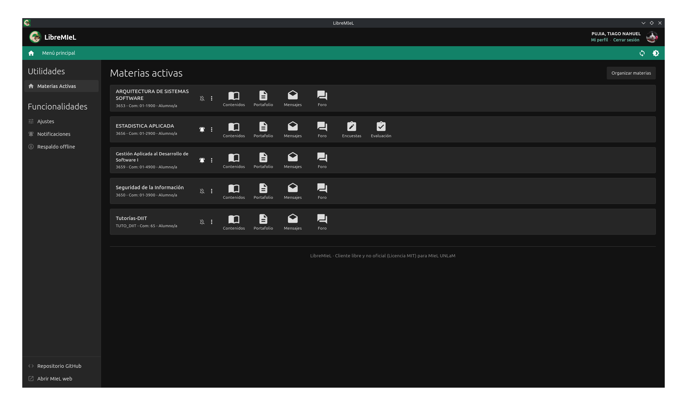

# LibreMIeL

Alternativa **gratuita, libre y open source** para usar **MIeL** desde tus dispositivos, creada por y para estudiantes.

> **Aviso:** LibreMIeL es un proyecto independiente de la comunidad. No es una aplicación oficial ni está afiliado a la Universidad Nacional de La Matanza.

---

## 🎯 Objetivo

Mejorar la experiencia diaria de cursada incorporando funciones útiles que hoy faltan en la plataforma oficial, manteniendo una interfaz ágil y fiel a MIeL.

**Funcionalidades principales:**

- **Notificaciones y widgets:** enterate al instante de nuevos archivos, entregas, mensajes, foros o evaluaciones, y accedé directo a cada materia desde las notificaciones o desde el widget de pantalla de inicio en Android.
- **Sincronización no invasiva:** revisa novedades en segundo plano sin borrar tus carteles rojos en la web oficial de MIeL, con filtro opcional en foros para recibir alertas solo cuando te mencionan o responden.
- **Modo sin conexión ante caídas:** seguí consultando tus materias, contenidos, mensajes, foros y entregas visitadas incluso si te quedás sin internet o si el servidor de MIeL está caído.
- **Experiencia fiel a MIeL:** un modelo pensado para sentirse lo más nativo posible a MIeL (en modo claro y oscuro) para leer y responder mensajes, subir entregas de Portafolio, revisar asistencias y participar en foros.
- **Respaldo completo de materias:** descargá foros enteros y todo el material de tus materias ordenado por carpetas con un solo clic para conservar tus apuntes antes de que cierre el cuatrimestre.
- **Sesión siempre activa:** iniciá sesión una sola vez con reconexión automática, cerrando tu cuenta únicamente cuando vos lo decidas.
- **Actualizaciones desde la app:** mantené LibreMIeL al día con avisos de nuevas versiones y actualización directa desde la aplicación.

**Próximamente:**

- **Buscador global sin conexión** para encontrar al instante cualquier archivo, mensaje, foro o entrega en todas tus materias.
- **Asistente de estudio con IA** para resumir apuntes, consultar dudas sobre el material de la cátedra y organizar el estudio.
- **Soporte para iPhone (iOS)** para llevar la misma experiencia local y privada al ecosistema móvil de Apple.

---

## 🖼️ Vista Previa

### Inicio de sesión

### Panel principal — Materias activas

---

## 💻 Sistemas Compatibles y Descargas

🌐 **Sitio web y centro de descargas:** **[tiago-pujia.github.io/LibreMIeL](https://tiago-pujia.github.io/LibreMIeL/)** *(o desde [GitHub Releases](https://github.com/Tiago-Pujia/LibreMIeL/releases))*

| Sistema Operativo                                           | Arquitecturas                                                        | Formatos disponibles                                              |
| ----------------------------------------------------------- | -------------------------------------------------------------------- | ----------------------------------------------------------------- |
| **Windows** (10 / 11)                                       | `x86_64` (64 bits) y `ARM64`                                         | Instalador (`.exe`) y portable (`.zip`)                           |
| **macOS**                                                   | Universal (`Intel x86_64` + `Apple Silicon ARM64`)                   | Instalador (`.dmg`) y portable (`.zip`)                           |
| **Linux** (Debian/Ubuntu, Fedora/Red Hat, Arch y derivadas) | `x86_64` (`amd64`) y `ARM64` (`aarch64`)                             | `AppImage`, `.deb`, `.rpm`, `.pkg.tar.zst` y portable (`.tar.gz`) |
| **Android**                                                 | Universal, `ARM64` (`arm64-v8a`), `ARMv7` (`armeabi-v7a`) y `x86_64` | Instalador `.apk`                                                 |

> [!TIP]
> **Notificaciones fiables en segundo plano en Android (Samsung One UI, Xiaomi MIUI/HyperOS, Motorola):**  
> Para que las notificaciones sigan llegando de forma puntual con la pantalla apagada o la app cerrada, configurá en tu dispositivo:  
> **Ajustes > Aplicaciones > LibreMIeL > Batería > Seleccionar "Sin restricciones"** *(Unrestricted)*.

---

## 📖 Documentación

Toda la documentación técnica, funcional y operativa del proyecto se encuentra centralizada y organizada en la carpeta `docs/`.

👉 **Accedé al índice y mapa de navegación completo en:** **[docs/README.md](docs/README.md)**
