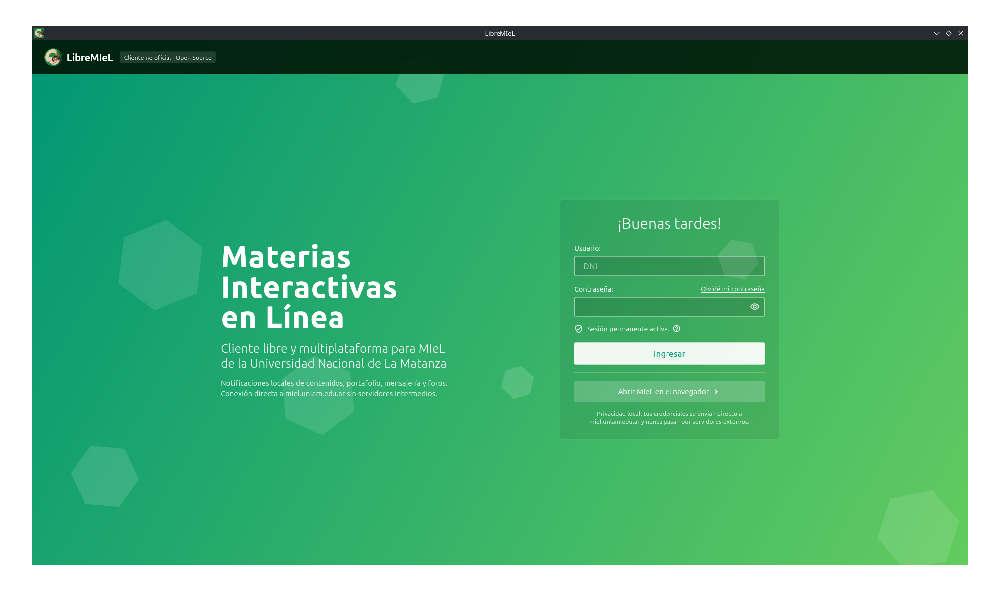

# LibreMIeL

Alternativa **gratuita, libre y open source** para usar **MIeL** desde tus dispositivos, creada por y para estudiantes.

> **Aviso:** LibreMIeL es un proyecto independiente de la comunidad. No es una aplicación oficial ni está afiliado a la Universidad Nacional de La Matanza.

---

## 🎯 Objetivo

Mejorar la experiencia diaria de cursada incorporando poco a poco funciones útiles que hoy faltan en la plataforma oficial.

**Funcionalidades principales:**

- **Notificaciones en tiempo real:** enterarte al instante de novedades en Contenidos, Portafolio, Mensajería, Foros o Evaluaciones.

- **Respaldo offline masivo:** descargar y respaldar **foros completos** (en Markdown, JSON y HTML offline) y **contenidos organizados** por carpeta con modo incremental.

- **Sesión permanente:** inicio de sesión automático y reconexión silenciosa continua, cerrando sesión solo cuando vos lo decidas.

**Próximamente:**

- **Buscador global offline (Fase 6)** para encontrar archivos, mensajes, foros y entregas en todas tus materias sin conexión.
- **Integración con IA (Fase 7)** para resumir apuntes, consultar dudas sobre el material de la cátedra y organizar el estudio.

---

## 🖼️ Vista Previa

### Inicio de sesión

### Panel principal — Materias activas

---

## 💻 Sistemas Compatibles y Descargas

🌐 **Sitio web y centro de descargas:** **[tiago-pujia.github.io/LibreMIeL](https://tiago-pujia.github.io/LibreMIeL/)** *(o desde [GitHub Releases](https://github.com/Tiago-Pujia/LibreMIeL/releases))*

| Sistema Operativo                                           | Arquitecturas                                                        | Formatos disponibles                                              |
| ----------------------------------------------------------- | -------------------------------------------------------------------- | ----------------------------------------------------------------- |
| **Windows** (10 / 11)                                       | `x86_64` (64 bits) y `ARM64`                                         | Instalador (`.exe`) y portable (`.zip`)                           |
| **macOS**                                                   | Universal (`Intel x86_64` + `Apple Silicon ARM64`)                   | Instalador (`.dmg`) y portable (`.zip`)                           |
| **Linux** (Debian/Ubuntu, Fedora/Red Hat, Arch y derivadas) | `x86_64` (`amd64`) y `ARM64` (`aarch64`)                             | `AppImage`, `.deb`, `.rpm`, `.pkg.tar.zst` y portable (`.tar.gz`) |
| **Android**                                                 | Universal, `ARM64` (`arm64-v8a`), `ARMv7` (`armeabi-v7a`) y `x86_64` | Instalador `.apk`                                                 |

> [!TIP]
> **Notificaciones fiables en segundo plano en Android (Samsung One UI, Xiaomi MIUI/HyperOS, Motorola):**  
> Para que las notificaciones sigan llegando de forma puntual con la pantalla apagada o la app cerrada, configurá en tu dispositivo:  
> **Ajustes > Aplicaciones > LibreMIeL > Batería > Seleccionar "Sin restricciones"** *(Unrestricted)*.

---

## 📖 Documentación

Toda la documentación técnica, funcional y operativa del proyecto se encuentra centralizada y organizada en la carpeta `docs/`.

👉 **Accedé al índice y mapa de navegación completo en:** **[docs/README.md](docs/README.md)**
