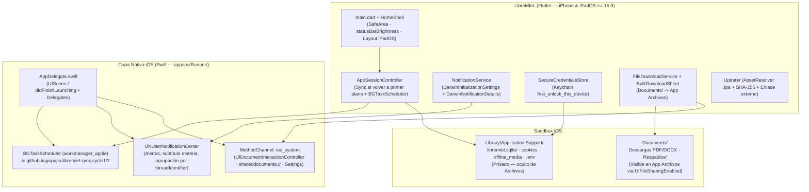

# Plan de Implementación: Fase 11 — Soporte para iOS e iPadOS (iPhone / iPad)

Este plan detalla la implementación completa de la **Fase 11** de **LibreMIeL** ([`ROADMAP.md`](ROADMAP.md#fase-11--soporte-para-ios-e-ipados-iphone--ipad-estado--pendiente) y [`STATUS.md`](STATUS.md)) para llevar el cliente a **iPhone** y **iPad** manteniendo intacta la arquitectura *local-first* (sin servidor central ni APNs), la paridad de lectura/escritura/respaldo/offline, la compilación automatizada de `.ipa` en **GitHub Actions (`macos-latest`)** sin requerir una Mac local y todas las invariantes de [`AGENTS.md`](AGENTS.md).

---

## Relevamiento Técnico Crítico del Repositorio Actual

Al auditar `app/pubspec.yaml`, `.flutter-plugins-dependencies`, `app/macos/` y los plugins ya resueltos en `.pub-cache` (Flutter `3.50.1` / Dart `^3.14.0`), surgieron **7 condicionantes reales** que determinan el diseño de esta fase:

1. **Identificador de paquete Apple sin guion bajo (`_`):**
   - Android utiliza `io.github.tiago_pujia.libremiel`, pero Apple prohíbe `_` en `CFBundleIdentifier` y `BGTaskSchedulerPermittedIdentifiers` (RFC 1034 / Xcode / AltStore / App Store Connect).
   - [`app/macos/Runner/Configs/AppInfo.xcconfig`](../app/macos/Runner/Configs/AppInfo.xcconfig#L11) ya adopta el identificador canónico Apple **`io.github.tiagopujia.libremiel`**. iOS debe usar exactamente **`io.github.tiagopujia.libremiel`** en `PRODUCT_BUNDLE_IDENTIFIER` y como prefijo de sus tareas `BGTaskScheduler`.

2. **Versión mínima real de iOS = `15.0` (no `13.0` / `14.0`):**
   - Todos los plugins móviles de `app/pubspec.yaml` ya están resueltos para iOS en `.flutter-plugins-dependencies` (`file_selector_ios`, `flutter_local_notifications`, `flutter_secure_storage_darwin`, `package_info_plus`, `path_provider_foundation`, `url_launcher_ios`, `workmanager_apple`), mientras que los plugins exclusivos de escritorio/Android (`tray_manager`, `window_manager`, `libremiel_android_widget`) quedan excluidos automáticamente en iOS.
   - Sin embargo, sus *podspecs* imponen estos pisos mínimos reales:
     - `package_info_plus-10.2.2`: iOS `12.0`
     - `flutter_local_notifications-23.0.3`, `flutter_secure_storage_darwin-0.4.3`, `url_launcher_ios-6.4.2`: iOS `13.0`
     - `workmanager_apple-0.9.11`: iOS `14.0`
     - **`file_selector_ios-0.5.3+7`: iOS `15.0`**
   - Por lo tanto, el *deployment target* de Xcode y `ios/Podfile` **debe fijarse en `15.0`** desde el inicio para que `pod install` y `flutter build ios` no fallen en `macos-latest`.

3. **Aislamiento obligatorio de SQLite (`Drift`) respecto de la app nativa Archivos (*Files*):**
   - `drift_flutter-0.3.1` almacena `$name.sqlite` en `getApplicationDocumentsDirectory()` por defecto.
   - Al habilitar `UIFileSharingEnabled = true` y `LSSupportsOpeningDocumentsInPlace = true` en `Info.plist` para que el estudiante vea sus PDFs y respaldos en **Archivos → En mi iPhone → LibreMIeL**, dejar SQLite en `Documents/` expondría `libremiel.sqlite`, `libremiel.sqlite-wal` y `libremiel.sqlite-shm` al usuario (riesgo de borrado accidental, corrupción y respaldo innecesario en iCloud).
   - **Solución:** en [`app_database.dart`](../app/lib/core/storage/app_database.dart), únicamente cuando `!kIsWeb && Platform.isIOS`, pasar `databaseDirectory: getApplicationSupportDirectory` dentro de `DriftNativeOptions` (igual que ya hacen [`miel_client.dart`](../app/lib/core/network/miel_client.dart), [`offline_media_service.dart`](../app/lib/core/storage/offline_media_service.dart) y [`secure_credentials_store.dart`](../app/lib/platform/secure_credentials_store.dart)).

4. **Accesibilidad del Keychain de iOS en segundo plano:**
   - El valor por defecto de `flutter_secure_storage` en iOS (`KeychainAccessibility.unlocked`) impide leer credenciales cuando `BGAppRefreshTask` ejecuta en segundo plano con el iPhone bloqueado.
   - Configurar `IOSOptions(accessibility: KeychainAccessibility.first_unlock_this_device)` en [`secure_credentials_store.dart`](../app/lib/platform/secure_credentials_store.dart) garantiza lectura segura en background tras el primer desbloqueo sin sincronizar secretos a iCloud Keychain.

5. **Ciclo de vida `UIScene` de Flutter 3.50+ y `workmanager_apple-0.9.11`:**
   - `BGTaskScheduler` solo entrega tareas en segundo plano si los *launch handlers* se registran durante `application(_:didFinishLaunchingWithOptions:)`.
   - En proyectos generados con Flutter 3.50+ (migración a `UIScene` / `FlutterImplicitEngineDelegate`), el registro de plugins puede ocurrir al conectar la escena (demasiado tarde para `BGTaskScheduler`).
   - Por eso `AppDelegate.swift` **debe** invocar explícitamente `WorkmanagerPlugin.registerLaunchHandlers()`, `WorkmanagerPlugin.setPluginRegistrantCallback`, `UNUserNotificationCenter.current().delegate = self as? UNUserNotificationCenterDelegate` y `FlutterLocalNotificationsPlugin.setPluginRegistrantCallback`.

6. **Limitaciones de sandbox en iOS para archivos y carpetas:**
   - `file_selector_ios-0.5.3+7` implementa `openFile` / `openFiles` (usando UTIs `public.data`), pero **no implementa `getDirectoryPath()`** (lanza `UnimplementedError` en [`BulkDownloadSheet`](../app/lib/features/downloads/bulk_download_sheet.dart#L115)).
   - En iOS, `launchUrl(Uri.file(...))` y `launchUrl(Uri.directory(...))` fallan por restricciones de sandbox en [`FileDownloadService`](../app/lib/platform/file_download_service.dart).
   - **Solución sin dependencias pesadas:** exponer un canal nativo mínimo en `AppDelegate.swift` (`MethodChannel('io.github.tiago_pujia.libremiel/ios_system')`) que presente `UIDocumentInteractionController` / `UIActivityViewController` para previsualizar/compartir descargas y abra `shareddocuments://<ruta>` para ir directo a la carpeta en la app **Archivos**.

7. **Actualizador in-app (Fase 8) y políticas de iOS:**
   - `AssetResolver.selectBestAsset` hoy no contempla `Platform.isIOS` (retorna `null`), y `UpdateInstaller` no puede autoinstalar `.ipa` desde dentro de la app.
   - Se debe detectar el artefacto `.ipa`, validar obligatoriamente su hash contra `SHA256SUMS.txt` (**Invariante #10**) y abrir el enlace oficial de actualización (GitHub Releases / AltStore / SideStore / TestFlight / App Store) en lugar de intentar ejecutar un instalador local.

---

## Arquitectura Técnica iOS / iPadOS



---

## Invariantes de Seguridad, Privacidad y Comportamiento ([`AGENTS.md`](AGENTS.md))

1. **Arquitectura 100% *local-first* sin servidor APNs:** No se introducen servidores intermedios, Firebase Cloud Messaging ni telemetría. Toda petición a MIeL sigue saliendo exclusivamente desde `MielClient` en el dispositivo del estudiante (**Regla #5**).
2. **Transparencia sobre sincronización en segundo plano en iOS:** iOS decide de forma heurística cuándo despertar `BGAppRefreshTask` (según batería, Modo de bajo consumo, *Actualización en segundo plano* y patrones de uso). La UI de **Ajustes** debe informarlo con claridad y garantizar sincronización inmediata al abrir o volver a primer plano.
3. **Presupuesto de ejecución en `BGAppRefreshTask` (~30 segundos):** El dispatcher en iOS debe ejecutar **Ciclo 1** de forma ágil (sin precarga masiva ni descargas pesadas en background) para evitar que el watchdog de iOS penalice futuras ventanas de ejecución.
4. **Respeto de efectos colaterales y privacidad multi-cuenta (Reglas #1–#3, #9, #11):**
   - `logout()` y cambio de cuenta limpian Keychain, `.env`, `CookieJar`, `libremiel.sqlite`, `offline_media`, y cancelan tareas pendientes en `BGTaskScheduler` (`Workmanager().cancelAll()`).
   - `PrivacyInfo.xcprivacy` declara explícitamente cero seguimiento (`NSPrivacyTracking = false`) y cero recolección de datos por terceros.
5. **Integridad del actualizador (Regla #10):** Incluso si iOS delega la instalación al enlace externo (GitHub Releases / AltStore / TestFlight), `UpdateChecker` sigue usando el cliente HTTP aislado con `ETag` y exigiendo coincidencia del `.ipa` dentro de `SHA256SUMS.txt`.

---

## Cambios Propuestos por Componente

### 1. Scaffolding y Configuración Nativa iOS (`app/ios/`)

#### [NEW] Scaffolding base `app/ios/`
Ejecutar desde `app/` (en entorno con Flutter SDK instalado):
```bash
cd /home/tiago/Proyectos/LibreMIEL/app
flutter create --platforms=ios --org io.github.tiagopujia --project-name libremiel .
```
> **Nota:** Verificar con `git status` que `flutter create` no sobrescriba `pubspec.yaml`, `lib/`, `test/` ni carpetas de otras plataformas (`android/`, `linux/`, `windows/`, `macos/`).

#### [MODIFY] `app/ios/Runner.xcodeproj/project.pbxproj` y `app/ios/Podfile`
- Fijar en todas las configuraciones (`Debug`, `Release`, `Profile`):
  - `PRODUCT_BUNDLE_IDENTIFIER = io.github.tiagopujia.libremiel` (y `io.github.tiagopujia.libremiel.RunnerTests` en el target de tests).
  - `IPHONEOS_DEPLOYMENT_TARGET = 15.0`.
  - `TARGETED_DEVICE_FAMILY = "1,2"` (soporte nativo para **iPhone** y **iPad**).
  - `MARKETING_VERSION` / `CURRENT_PROJECT_VERSION` enlazados a `$(FLUTTER_BUILD_NAME)` y `$(FLUTTER_BUILD_NUMBER)`.
- En `app/ios/Podfile`:
  - Descomentar y fijar `platform :ios, '15.0'`.
  - En `post_install`, asegurar `config.build_settings['IPHONEOS_DEPLOYMENT_TARGET'] = '15.0'` para cada target de pods (evita warnings y errores de Xcode modernos con pods heredados).

#### [MODIFY] `app/ios/Runner/Info.plist`
Configurar claves obligatorias para notificaciones, segundo plano, integración con **Archivos** e iPadOS:
- `CFBundleDisplayName`: `LibreMIeL`
- `CFBundleName`: `LibreMIeL`
- **App Archivos (*Files*):**
  - `UIFileSharingEnabled`: `<true/>`
  - `LSSupportsOpeningDocumentsInPlace`: `<true/>`
- **Ejecución en segundo plano (`BGTaskScheduler`):**
  - `UIBackgroundModes`: `<array><string>fetch</string><string>processing</string></array>`
  - `BGTaskSchedulerPermittedIdentifiers`:
    ```xml
    <array>
      <string>io.github.tiagopujia.libremiel.sync.cycle1</string>
      <string>io.github.tiagopujia.libremiel.sync.cycle2</string>
    </array>
    ```
- **Declaración de cifrado estándar (evita bloqueos en TestFlight / App Store Connect):**
  - `ITSAppUsesNonExemptEncryption`: `<false/>` (solo HTTPS estándar del SO).
- **Esquemas externos (`url_launcher`):**
  - `LSApplicationQueriesSchemes`: `https`, `http`, `shareddocuments`, `altstore`, `sidestore`.
- **Soporte iPhone + iPadOS (Split View / Slide Over):**
  - `UIRequiresFullScreen`: `<false/>`
  - `UISupportedInterfaceOrientations`: Portrait + LandscapeLeft + LandscapeRight.
  - `UISupportedInterfaceOrientations~ipad`: las 4 orientaciones (incluido PortraitUpsideDown).

#### [MODIFY] `app/ios/Runner/AppDelegate.swift`
Implementar arranque limpio compatible con `UIScene` / Flutter 3.50+, `workmanager_apple`, `flutter_local_notifications` y el canal `ios_system`:
1. En `application(_:didFinishLaunchingWithOptions:)`:
   - `UNUserNotificationCenter.current().delegate = self as? UNUserNotificationCenterDelegate`
   - `WorkmanagerPlugin.setPluginRegistrantCallback { registry in GeneratedPluginRegistrant.register(with: registry) }`
   - `FlutterLocalNotificationsPlugin.setPluginRegistrantCallback { registry in GeneratedPluginRegistrant.register(with: registry) }`
   - `WorkmanagerPlugin.registerLaunchHandlers()` (re-registra *launch handlers* antes de retornar `didFinishLaunching`, obligatorio bajo ciclo `UIScene`).
   - Registrar explícitamente los identificadores `io.github.tiagopujia.libremiel.sync.cycle1` y `io.github.tiagopujia.libremiel.sync.cycle2` con `WorkmanagerPlugin.registerPeriodicTask(withIdentifier:earliestBeginInSeconds:)`.
2. Registrar `FlutterMethodChannel(name: "io.github.tiago_pujia.libremiel/ios_system", binaryMessenger: ...)` (en `didInitializeImplicitFlutterEngine` si adopta `FlutterImplicitEngineDelegate`, o en `didFinishLaunchingWithOptions` según plantilla generada por Flutter 3.50):
   - **`previewFile(path: String)`**: crea `UIDocumentInteractionController(url: URL(fileURLWithPath: path))` tomando el `UIViewController` raíz activo y llama a `presentPreview(animated: true)` (con fallback a `UIActivityViewController` para compartir/guardar si el formato no soporta QuickLook; en iPad configurar `popoverPresentationController?.sourceView` para evitar crash por popover sin ancla!).
   - **`openFilesFolder(path: String)`**: abre `shareddocuments://` apuntando a la ruta en `Documents/` vía `UIApplication.shared.open(...)`.
   - **`openAppSettings()`**: abre `UIApplication.openSettingsURLString`.
   - **`getBackgroundRefreshStatus()`**: retorna `'available'`, `'denied'` o `'restricted'` desde `UIApplication.shared.backgroundRefreshStatus`.
   - **`getNotificationAuthorizationStatus()`**: consulta `UNUserNotificationCenter.current().getNotificationSettings` y retorna `'authorized'`, `'provisional'`, `'denied'` o `'notDetermined'`.

#### [NEW] `app/ios/Runner/PrivacyInfo.xcprivacy`
Manifiesto de privacidad exigido por Apple (iOS 17+ / App Store Connect):
- `NSPrivacyTracking`: `false`
- `NSPrivacyTrackingDomains`: `[]`
- `NSPrivacyCollectedDataTypes`: `[]`
- `NSPrivacyAccessedAPITypes`:
  - `NSPrivacyAccessedAPICategoryUserDefaults` con razón `CA92.1` (uso exclusivo de la app / plugins locales).
  - `NSPrivacyAccessedAPICategoryFileTimestamp` con razón `C617.1` (lectura de timestamps de descargas y caché offline dentro del contenedor propio).

#### [NEW] Íconos de iOS (`app/ios/Runner/Assets.xcassets/AppIcon.appiconset/`)
- Generar todas las resoluciones estándar de `AppIcon.appiconset` (incluyendo `1024×1024` para App Store / AltStore) a partir de [`app/assets/icons/libremiel.png`](../app/assets/icons/libremiel.png) **aplanando el canal alfa** sobre fondo sólido (Apple rechaza íconos con transparencia en TestFlight/App Store).
- Adaptar `LaunchScreen.storyboard` con fondo esmeralda `#009674` (o adaptativo claro/oscuro) y marca limpia sin estiramientos.

---

### 2. Capa de Plataforma Dart: Storage, Keychain, Notificaciones, Archivos y Background (`app/lib/`)

#### [MODIFY] [`app/lib/core/storage/app_database.dart`](../app/lib/core/storage/app_database.dart)
- Importar `dart:io`, `package:flutter/foundation.dart` y `package:path_provider/path_provider.dart`.
- En el constructor por defecto de `AppDatabase`, configurar:
  ```dart
  DriftNativeOptions(
    shareAcrossIsolates: true,
    databaseDirectory: (!kIsWeb && Platform.isIOS)
        ? getApplicationSupportDirectory
        : null,
    setup: _configureSqliteConnection,
  )
  ```
- Mantiene intactas las rutas actuales en Android, Linux, Windows y macOS, y protege `libremiel.sqlite` fuera de `Documents/` en iOS.

#### [MODIFY] [`app/lib/platform/secure_credentials_store.dart`](../app/lib/platform/secure_credentials_store.dart)
- Instanciar el `FlutterSecureStorage` por defecto con opciones seguras de Apple:
  ```dart
  const FlutterSecureStorage(
    iOptions: IOSOptions(
      accessibility: KeychainAccessibility.first_unlock_this_device,
      synchronizable: false,
    ),
  )
  ```
- En `storageBackendLabel`, agregar la rama de iOS:
  ```dart
  if (!kIsWeb && Platform.isIOS) {
    return 'Apple Keychain (iOS) + respaldo privado de la app';
  }
  ```
- Nota de seguridad: verificar que `_chmod600` continúa restringido exclusivamente a `Platform.isLinux || Platform.isMacOS` (jamás `Process.run` en iOS).
- Opcional recomendado (limpieza post-reinstalación en iOS): dado que el Keychain de iOS persiste tras desinstalar una app, en el primer arranque tras una instalación limpia (detectable mediante una bandera en `AppDatabase` o archivo marcador en `Application Support` que SÍ se borra al desinstalar), si no existe marcador local pero sí credenciales antiguas en Keychain, limpiar Keychain o conservar comportamiento documentado — **recomendación:** si `app_database` está recién creada (`accountUsername == null` y sin `.env` local) y `Platform.isIOS`, limpiar entradas huérfanas de Keychain para evitar re-autenticar una cuenta previa tras desinstalar la app.

#### [NEW] `app/lib/platform/ios_system_service.dart`
Servicio puente limpio y testeable (siguiendo el patrón exacto de [`AndroidSystemService`](../app/lib/platform/android_system_service.dart)):
- `MethodChannel('io.github.tiago_pujia.libremiel/ios_system')`
- Constructor `const IosSystemService({MethodChannel? channel, this.isIosOverride})`.
- `bool get isSupported => isIosOverride ?? (!kIsWeb && Platform.isIOS);`
- Enum `IosBackgroundRefreshStatus { available, denied, restricted, unknown }`.
- Métodos seguros (devuelven `false` / `null` / `unknown` fuera de iOS o ante `PlatformException`/`MissingPluginException`):
  - `Future<bool> previewFile(String filePath)`
  - `Future<bool> openFilesFolder(String directoryPath)`
  - `Future<bool> openAppSettings()`
  - `Future<IosBackgroundRefreshStatus> getBackgroundRefreshStatus()`
  - `Future<String?> getNotificationAuthorizationStatus()`
- Registrar `iosSystemServiceProvider` en [`app_providers.dart`](../app/lib/app/app_providers.dart).

#### [MODIFY] [`app/lib/platform/file_download_service.dart`](../app/lib/platform/file_download_service.dart)
- Constructor opcional `const FileDownloadService({this.iosSystemService = const IosSystemService(), this.isIosOverride});`.
- En `resolveDownloadsDirectory()`:
  - Si `!kIsWeb && _isIOS`: devolver directamente `getApplicationDocumentsDirectory()` (asegurando que exista), porque en la app **Archivos** de iOS el contenedor ya aparece nombrado **LibreMIeL** (`En mi iPhone → LibreMIeL`), evitando anidar `LibreMIeL/LibreMIeL`.
  - Mantener `Downloads/LibreMIeL` en escritorio y Android sin cambios.
- En `openDownloadedFile(String filePath)`:
  - Si `_isIOS`: invocar `iosSystemService.previewFile(filePath)` (presentando QuickLook / hoja de compartir nativa sin intentar `Uri.file`).
- En `openContainingFolder(String filePath)`:
  - Si `_isIOS`: invocar `iosSystemService.openFilesFolder(dirPath)` (abriendo la app **Archivos** en la carpeta correspondiente).

#### [MODIFY] [`app/lib/platform/notification_service.dart`](../app/lib/platform/notification_service.dart)
- Agregar `@visibleForTesting final bool? isIosOverride;` y getter `bool get _isIOS => isIosOverride ?? (!kIsWeb && Platform.isIOS);`.
- En `initialize({bool requestPermissions = true})`:
  - Añadir configuración de iOS dentro de `InitializationSettings`:
    ```dart
    iOS: const DarwinInitializationSettings(
      requestAlertPermission: false,
      requestBadgePermission: false,
      requestSoundPermission: false,
      defaultPresentAlert: true,
      defaultPresentBadge: true,
      defaultPresentSound: true,
      defaultPresentBanner: true,
      defaultPresentList: true,
    ),
    ```
  - **Crítico:** dejar `request*Permission: false` en `DarwinInitializationSettings` para que una ejecución *headless* de `BGAppRefreshTask` (`initialize(requestPermissions: false)`) nunca intente abrir el diálogo de permisos en segundo plano.
  - Cuando `_isIOS && requestPermissions`: resolver `IOSFlutterLocalNotificationsPlugin` e invocar `await iosPlugin?.requestPermissions(alert: true, badge: true, sound: true);` dentro de un bloque `try/catch` (espejo de `_requestAndroidPermissionSafely`).
- En `areNotificationsEnabled()`:
  - Soportar `_isIOS` consultando `iosPlugin?.checkPermissions()` (retornando `perms?.isEnabled`).
- En `showBatch(...)`:
  - Agregar `iOS: DarwinNotificationDetails(subtitle: n.subjectName.isNotEmpty ? n.subjectName : null, threadIdentifier: groupKey, presentAlert: true, presentBanner: true, presentList: true, presentSound: true, presentBadge: true)` para mostrar el nombre de la materia como subtítulo y agrupar alertas por comisión en el Centro de Notificaciones de iOS.
- En `showUpdateNotification(...)` y `showMielRecoveredNotification()`:
  - Agregar `iOS: const DarwinNotificationDetails(...)` con subtítulo y opciones de presentación en primer plano.

#### [MODIFY] [`app/lib/platform/android_background_worker.dart`](../app/lib/platform/android_background_worker.dart)
Extender el worker móvil existente de forma 100% retrocompatible (conservando nombres públicos y tests actuales):
- Añadir identificadores Apple reverse-DNS sin guion bajo:
  - `const String kIosCycle1TaskName = 'io.github.tiagopujia.libremiel.sync.cycle1';`
  - `const String kIosCycle2TaskName = 'io.github.tiagopujia.libremiel.sync.cycle2';`
- En `runAndroidBackgroundSyncTask(...)`:
  - Reconocer Ciclo 2 tanto en Android como en iOS: `final isCycle2 = taskName == kAndroidCycle2TaskName || taskName == kIosCycle2TaskName;`.
  - Mantener `notifications.initialize(requestPermissions: false)` al inicio (válido para ambos SOs en modo *headless*).
  - `_syncWidgetAfterBackgroundRun` sigue siendo *no-op* en iOS porque `AndroidWidgetService.isSupported` es `false` fuera de Android.
- En `AndroidBackgroundWorker` (o alias `MobileBackgroundWorker` apuntando a la misma clase):
  - `static bool get _isMobilePlatform => !kIsWeb && (Platform.isAndroid || Platform.isIOS);`
  - `ensureInitialized()`: habilitar para `_isMobilePlatform`.
  - `schedule({required int intervalMinutes, bool updateExisting = false})`:
    - Si `Platform.isAndroid`: mantener exactamente el registro actual (`kAndroidCycle1TaskName`, `kAndroidCycle2TaskName`).
    - Si `Platform.isIOS`: registrar con `Workmanager().registerPeriodicTask(...)` usando `kIosCycle1TaskName` (con `initialDelay: Duration(minutes: safeCycle1)` y `frequency: Duration(minutes: safeCycle1)`) y `kIosCycle2TaskName` (con `frequency: Duration(minutes: safeCycle2)`), ambos con `Constraints(networkType: NetworkType.connected)`.
  - `cancelAll()`: habilitar para `_isMobilePlatform` (envuelto en `try/catch` en iOS).

---

### 3. Actualizador In-App en iOS (`app/lib/platform/updater/` y `app/lib/features/updates/`)

#### [MODIFY] [`app/lib/platform/updater/asset_resolver.dart`](../app/lib/platform/updater/asset_resolver.dart)
- Reconocer `Platform.isIOS ? 'ios'` en `selectBestAsset(...)` y aceptar `overrideOs: 'ios'`.
- Implementar `_selectIosAsset(List<Map<String, dynamic>> assets)`:
  1. Priorizar `.ipa` firmado (`name.contains('ios') && !name.contains('unsigned') && name.endsWith('.ipa')`) si existiera.
  2. Fallback a `.ipa` sin firma para sideloading (`name.contains('ios') && name.endsWith('.ipa')`).
  3. Fallback general a cualquier `.ipa` del release.

#### [MODIFY] [`app/lib/platform/updater/update_models.dart`](../app/lib/platform/updater/update_models.dart), [`update_installer.dart`](../app/lib/platform/updater/update_installer.dart), [`updater_controller.dart`](../app/lib/platform/updater/updater_controller.dart) y [`update_dialog.dart`](../app/lib/features/updates/update_dialog.dart)
- Definir soporte explícito para actualizaciones asistidas por enlace externo en iOS:
  - Constantes configurables en compilación vía `String.fromEnvironment`:
    - `IOS_DISTRIBUTION_CHANNEL` (`'sideload'` por defecto; soporta `'testflight'` y `'appstore'`).
    - `IOS_UPDATE_URL` (URL oficial de TestFlight o App Store cuando exista; si está vacía, usa `https://github.com/Tiago-Pujia/LibreMIeL/releases/tag/${release.tagName}`).
  - En `UpdateInstaller`: agregar `static bool get usesExternalStoreOrReleasePage => !kIsWeb && Platform.isIOS;` y método `Future<bool> openExternalUpdatePage(ReleaseInfo release)` usando `launchUrl(..., mode: LaunchMode.externalApplication)` (validando dominio HTTPS confiable: `github.com`, `testflight.apple.com`, `apps.apple.com`, o `altstore://` si corresponde).
  - En `UpdaterNotifier`: añadir `Future<void> openExternalUpdate()` para iOS sin descargar el `.ipa` dentro del sandbox interno.
  - En [`UpdateDialog`](../app/lib/features/updates/update_dialog.dart): cuando se corre en iOS (`Platform.isIOS` o parámetro `isExternalUpdateOnly` inyectable para tests), mostrar las notas de versión y el nombre del `.ipa` verificado contra `SHA256SUMS.txt`, aclarar brevemente que iOS requiere instalar la actualización desde AltStore / SideStore / TestFlight / App Store, y reemplazar el botón `[Actualizar ahora]` por **`[Abrir descarga]`** (`Icons.open_in_new`).

---

### 4. Integración en Arranque, Ciclo de Vida, UI iPhone / iPadOS y Ajustes

#### [MODIFY] [`app/lib/main.dart`](../app/lib/main.dart)
- Inicializar `WorkManager` en Android **y** iOS:
  ```dart
  if (!kIsWeb && (Platform.isAndroid || Platform.isIOS)) {
    try {
      await AndroidBackgroundWorker.ensureInitialized();
    } catch (_) {}
  }
  ```

#### [MODIFY] [`app/lib/app/app_providers.dart`](../app/lib/app/app_providers.dart)
- Registrar `iosSystemServiceProvider` e inyectar `IosSystemService` en `fileDownloadServiceProvider`.
- En `_startBackgroundSchedulers(...)`: cambiar `if (Platform.isAndroid)` por `if (Platform.isAndroid || Platform.isIOS)` para registrar las tareas `BGAppRefreshTask` en iOS.
- En `logout()`: `AndroidBackgroundWorker.cancelAll()` ahora también cancela tareas pendientes de `BGTaskScheduler` en iOS.

#### [MODIFY] [`app/lib/features/home/home_shell.dart`](../app/lib/features/home/home_shell.dart)
- En `didChangeAppLifecycleState(AppLifecycleState state)`:
  - En `AppLifecycleState.resumed`:
    - Si `Platform.isAndroid || Platform.isIOS`: invocar `ref.read(databaseProvider).notifyExternalTableUpdates()` (sincroniza streams de Drift si `BGAppRefreshTask` corrió en segundo plano).
    - Si `Platform.isIOS`: además disparar una sincronización en primer plano con *cooldown* mínimo de 2 minutos (`_lastIosResumeSyncAt`) para compensar la naturaleza oportunista de `BGTaskScheduler` y garantizar novedades frescas apenas el estudiante abre la app.
- En `SystemUiOverlayStyle` (líneas 371–379): agregar `statusBarBrightness: isDark ? Brightness.dark : Brightness.light` para contraste correcto de hora/batería/señal en iPhone y iPad.
- **Revisión responsive iPhone / iPadOS:**
  - Verificar que `SafeArea(top: false)` en el `Scaffold.body` y `SafeArea(bottom: false)` en `_MielDoubleHeader` respetan *Dynamic Island* / *notch* (en vertical y horizontal) y la barra inferior de gestos (*Home Indicator*).
  - En **iPadOS**, el breakpoint `hasDesktopSidebar = width > 992` ya muestra la barra lateral persistente de `230px` en horizontal (iPad Air / iPad Pro `1024–1366pt`) y colapsa limpiamente al `Drawer` deslizable en vertical o *Split View* (`<= 992pt`), manteniendo la barra de perfil superior completa cuando `width > 600`.
  - Verificar en tests de widget que no haya desbordes en:
    - iPhone 15 Pro (`393×852`, `viewPadding: EdgeInsets.only(top: 59, bottom: 34)`)
    - iPhone SE (`375×667`, `viewPadding: EdgeInsets.only(top: 20)`)
    - iPad Air vertical (`820×1180`) y horizontal (`1180×820`)

#### [MODIFY] [`app/lib/features/auth/login_screen.dart`](../app/lib/features/auth/login_screen.dart)
- Agregar `statusBarBrightness: Brightness.dark` al `SystemUiOverlayStyle` del fondo esmeralda.
- Envolver el formulario en `AutofillGroup` con `autofillHints: [AutofillHints.username]` / `[AutofillHints.password]` para que funcione con el llavero de contraseñas de iOS/iPadOS si el estudiante lo usa.

#### [MODIFY] [`app/lib/features/settings/settings_screen.dart`](../app/lib/features/settings/settings_screen.dart)
- En el panel *"Inicio del sistema"*: diferenciar el texto informativo de respaldo cuando `!session.autostartSupported`:
  - Android: texto actual sobre `WorkManager`.
  - iOS: *"En iOS, las comprobaciones en segundo plano se ejecutan de forma oportunista mediante BGTaskScheduler según la gestión de batería del sistema, y siempre se sincroniza al abrir la app."*
- Cuando `!kIsWeb && Platform.isIOS`, renderizar un nuevo widget **`_IosBackgroundHealthSection`** (espejo de `_AndroidBackgroundHealthSection`):
  - **Estado de *"Actualización en segundo plano"*:** consulta `iosSystemService.getBackgroundRefreshStatus()` (`Disponible`, `Desactivada` o `Restringida`) y al tocar abre Ajustes de iOS (`openAppSettings()`).
  - **Estado de notificaciones de iOS:** consulta `getNotificationAuthorizationStatus()` / `areNotificationsEnabled()` y permite abrir Ajustes de iOS para habilitarlas.
  - **Acceso a archivos descargados:** informa la ubicación *"Archivos → En mi iPhone/iPad → LibreMIeL"* y ofrece botón para abrir directamente la carpeta en la app **Archivos** (`openFilesFolder`).
- En la sección *"Sincronización"*: adaptar el subtítulo de frecuencia cuando `Platform.isIOS` para explicar que iOS toma el intervalo como sugerencia mínima (*earliestBeginDate*) y no garantiza exactitud por minuto sin servidor push remoto.

#### [MODIFY] [`app/lib/features/downloads/bulk_download_sheet.dart`](../app/lib/features/downloads/bulk_download_sheet.dart)
- En `_initDefaultDestination()`: con el cambio de `FileDownloadService.resolveDownloadsDirectory()`, en iOS el destino por defecto queda en `<Documents>/Respaldos` (visible en **Archivos → LibreMIeL → Respaldos**).
- En `_pickDestinationFolder()` y en el botón *"Cambiar"* de la UI: cuando `!kIsWeb && Platform.isIOS`, ocultar el botón que llama a `getDirectoryPath()` (evitando `UnimplementedError` de `file_selector_ios`) y mostrar la etiqueta clara *"Carpeta en app Archivos: LibreMIeL / Respaldos"*.
- En `_openDestinationFolder()`: si `!kIsWeb && Platform.isIOS`, invocar `ref.read(iosSystemServiceProvider).openFilesFolder(_destinationPath)` en lugar de `launchUrl(Uri.directory(...))`.

---

### 5. CI/CD en GitHub Actions (sin Mac local) y Distribución

#### [MODIFY] [`.github/workflows/release.yml`](../.github/workflows/release.yml)
1. Actualizar el nombre del workflow para incluir **iOS/iPadOS**.
2. Agregar job **`build-ios`** corriendo sobre `runs-on: macos-latest` (`needs: prepare`):
   - `actions/checkout@v4` + `subosito/flutter-action@v2` (`channel: stable`, `cache: true`).
   - `flutter pub get` dentro de `app/`.
   - Ejecutar `pod install` en `app/ios` (si existe `Podfile`; cacheando CocoaPods opcionalmente).
   - **Camino 1 — Build comunitario gratuito sin firma (siempre disponible en repositorios públicos, sin Apple Developer Program):**
     ```bash
     VERSION="${{ needs.prepare.outputs.version }}"
     BUILD_NUM="${{ github.run_number }}"
     flutter build ios --release --no-codesign \
       --build-name="$VERSION" \
       --build-number="$BUILD_NUM" \
       --dart-define=IOS_DISTRIBUTION_CHANNEL=sideload

     mkdir -p ../dist/ios Payload
     cp -R build/ios/iphoneos/Runner.app Payload/LibreMIeL.app
     zip -r -y "../dist/ios/LibreMIeL-${VERSION}-ios-unsigned.ipa" Payload
     rm -rf Payload
     ```
   - **Camino 2 — Build firmado opcional (cuando existan *GitHub Secrets* de Apple Developer Program):**
     - Si `secrets.IOS_CERTIFICATE_BASE64` y `secrets.IOS_PROVISIONING_PROFILE_BASE64` están definidos:
       - Crear keychain temporal de CI (`security create-keychain`), importar `.p12`, copiar `.mobileprovision` a `~/Library/MobileDevice/Provisioning Profiles/` y ejecutar `flutter build ipa --release --export-options-plist=...`, exportando `LibreMIeL-${VERSION}-ios.ipa` (listo para distribución en **TestFlight** / **App Store**).
       - Opcionalmente subir a TestFlight con `xcrun altool` / App Store Connect API Key si `secrets.APP_STORE_CONNECT_API_KEY_BASE64` está presente.
   - Subir artefacto `dist-ios` (`path: dist/ios/*`).
3. Añadir `build-ios` a `needs` de **`publish-release`** para incluir el `.ipa` automáticamente en `SHA256SUMS.txt` y adjuntarlo en el GitHub Release.

#### [MODIFY] [`.github/workflows/ci.yml`](../.github/workflows/ci.yml)
- Mantener `analyze-and-test` rápido en `ubuntu-latest` para todos los PRs/pushes.
- Agregar un job opcional **`ios-build-check`** sobre `runs-on: macos-latest` (ejecutable en PRs a `main` o cuando cambien rutas `app/ios/**`, `app/pubspec.*`, `app/lib/platform/**`) que valide `flutter build ios --release --no-codesign` para detectar roturas de Swift/CocoaPods/Xcode antes de tagear un release.

#### [MODIFY] [`packaging/web/app.js`](../packaging/web/app.js) y [`packaging/web/index.html`](../packaging/web/index.html)
- Añadir entrada `ios` en `OS_META` (`recommendedSuffix: "-ios-unsigned.ipa"`, detección en User-Agent para iPhone/iPad incluyendo `iPadOS` con `navigator.platform === 'MacIntel' && navigator.maxTouchPoints > 1`).
- Añadir pestaña **iOS / iPadOS** en el Centro de Descargas de GitHub Pages con:
  1. Enlace directo al `.ipa` del último GitHub Release y nota de verificación SHA-256.
  2. Guía breve paso a paso para instalación gratuita con **AltStore / SideStore / Sideloadly** (aclarando la renovación semanal exigida por Apple para Apple IDs gratuitos).
  3. Espacio preparado para enlace de **TestFlight / App Store** cuando exista cuenta Apple Developer.

---

## Flujo de Desarrollo y Validación desde Linux (sin Mac Local)

Dado que Xcode y el *iOS Simulator* requieren macOS, el flujo de trabajo desde Linux sigue 3 capas:

1. **Desarrollo y pruebas locales en Linux (iteración rápida):**
   - Escribir toda la lógica multiplataforma Dart con overrides testeables (`isIosOverride`, `overrideOs: 'ios'`, `Platform` inyectado) y validar responsive de iPhone (`393×852` con padding *Dynamic Island* + *Home Indicator*) e iPadOS (`820×1180` y `1180×820`) con `flutter test`.
   - Mantener verificación visual móvil rápida en el emulador Android existente (`LibreMIeL_Pixel7`).
2. **Validación de compilación nativa Swift/CocoaPods/Xcode en la nube:**
   - Disparar el workflow [`release.yml`](../.github/workflows/release.yml) vía `workflow_dispatch` (rama `DEV`) en `macos-latest` para obtener el artefacto `LibreMIeL-0.1.0-dev-ios-unsigned.ipa` y verificar cero errores de Swift, `Podfile`, `PrivacyInfo.xcprivacy` y `AppIcon`.
3. **Prueba funcional en iPhone / iPad real:**
   - Instalar el `.ipa` generado por Actions en un iPhone/iPad físico usando **Sideloadly**, **AltStore** o **SideStore** (gratuito con Apple ID común), comprobando: login + Keychain, aparición de descargas en app **Archivos**, previsualización con QuickLook, permisos/llegada de notificaciones locales, `BGAppRefreshTask`, vista de iPadOS y diálogo de actualización externa.

---

## Plan de Verificación

### Pruebas Automatizadas (Flutter / Dart — ejecutables en Linux)

1. **`app/test/platform/ios_system_service_test.dart`** (`[NEW]`):
   - Mock del `MethodChannel('io.github.tiago_pujia.libremiel/ios_system')` verificando `previewFile`, `openFilesFolder`, `openAppSettings`, `getBackgroundRefreshStatus` (`available`/`denied`/`restricted`/`unknown`), `getNotificationAuthorizationStatus` y comportamiento *no-op* fuera de iOS.
2. **`app/test/platform/file_download_service_ios_test.dart`** (`[NEW]`):
   - Verificar que en iOS `openDownloadedFile` delega a `IosSystemService.previewFile` y `openContainingFolder` delega a `IosSystemService.openFilesFolder` (sin invocar `Process.run` ni `Uri.file`).
3. **`app/test/platform/notification_service_test.dart`** (`[MODIFY]`):
   - Verificar inicialización en iOS (`isIosOverride: true`): `requestPermissions: false` **no** solicita permisos (modo *headless* `BGAppRefreshTask`), `requestPermissions: true` invoca `IOSFlutterLocalNotificationsPlugin.requestPermissions(...)`, y `showBatch` / `showUpdateNotification` / `showMielRecoveredNotification` incluyen `DarwinNotificationDetails` con `subtitle` y `threadIdentifier`.
4. **`app/test/platform/android_background_worker_test.dart`** (`[MODIFY]`):
   - Verificar que `kIosCycle1TaskName` ejecuta `runCycle1` y `kIosCycle2TaskName` ejecuta `runCycle2` inicializando notificaciones con `requestPermissions: false`.
5. **`app/test/updater/asset_resolver_test.dart`** y **`app/test/updater/update_dialog_test.dart`** (`[MODIFY]`):
   - Verificar selección de `.ipa` en `AssetResolver.selectBestAsset(..., overrideOs: 'ios')` (priorizando firmado sobre `unsigned`).
   - Verificar que en modo iOS `UpdateDialog` muestra botón de enlace externo (`Abrir descarga`) en lugar de descargar/autoinstalar.
6. **`app/test/widget_test.dart`** (`[MODIFY]`):
   - Tests responsive de `HomeShell` en viewports **iPhone 15 Pro** (`393×852`, `viewPadding` top `59` / bottom `34`) e **iPadOS** (`1180×820` con sidebar fijo `230px` y `820×1180` con Drawer) sin desbordes.

### Comandos de Verificación

```bash
# Desde app/ (local en Linux y en CI):
cd /home/tiago/Proyectos/LibreMIEL/app
flutter pub get
dart format --output=none --set-exit-if-changed lib test
flutter analyze
flutter test

# Desde la raíz del repo:
cd /home/tiago/Proyectos/LibreMIEL
python3 -m unittest discover -s scripts -v

# En GitHub Actions (macos-latest):
cd /home/tiago/Proyectos/LibreMIEL/app
flutter build ios --release --no-codesign --build-name="0.1.0-dev" --build-number="1"
```

### Cierre Documental (al completar la fase y validar el `.ipa` en `macos-latest`)

- Actualizar [`STATUS.md`](STATUS.md), [`ROADMAP.md`](ROADMAP.md), [`AGENTS.md`](AGENTS.md) (lista de plataformas objetivo incluyendo iOS/iPadOS) y [`CHANGELOG.md`](CHANGELOG.md) marcando **Fase 11 — Soporte para iOS e iPadOS** como `✅ Completado`.
