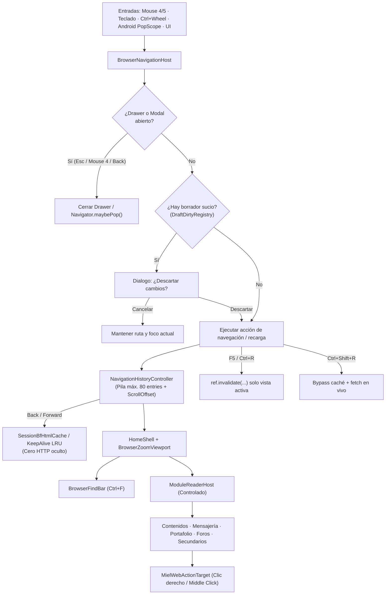

# Plan de Implementación: Fase 12 — Navegación y Experiencia tipo Navegador Web

Este plan detalla la implementación completa de la **Fase 12** de **LibreMIeL** ([`ROADMAP.md`](ROADMAP.md#fase-12--navegación-y-experiencia-tipo-navegador-web-estado--pendiente), [`STATUS.md`](STATUS.md) y resumen inicial en [`IMPLEMENTATION_PLAN.md`](IMPLEMENTATION_PLAN.md#fase-12--navegación-y-experiencia-tipo-navegador-web-planificado)) manteniendo la arquitectura de **ventana única**, la fidelidad visual con **MIeL UNLaM** y el respeto estricto de todas las invariantes técnicas definidas en [`AGENTS.md`](AGENTS.md).

---

## Contexto Actual del Código Relevado

Antes de editar archivos, tener en cuenta estas particularidades reales de la base actual en `app/`:

1. **Paquete UI unificado (`material_ui`):** Todo el proyecto importa `package:material_ui/material_ui.dart` en lugar de `package:flutter/material.dart`. Usar `package:material_ui/material_ui.dart` junto con `package:flutter/services.dart`, `package:flutter/gestures.dart` y `package:flutter/foundation.dart` para evitar conflictos de nombres o imports duplicados.
2. **Navegación fragmentada actualmente:**
   - [`HomeShell`](../app/lib/features/home/home_shell.dart) administra solo el nivel macro (`_ShellSection`, `_activeSubjectId`, `_activeTool`, `_activeModuleSectionIndex`, `_activeForoTopicId`).
   - [`MensajeriaView`](../app/lib/features/modules/mensajeria_view.dart) mantiene en estado privado local `_selectedMessage`, `_currentPage`, `_unifiedCrossSubjectMode`, `_inlineComposeMode` y `_showFilters`.
   - [`PortafolioView`](../app/lib/features/modules/portafolio_view.dart) mantiene en estado privado local `_selectedPractice`.
   - [`ForoView`](../app/lib/features/modules/foro_view.dart) ya acepta `selectedTopicId` / `onSelectTopic`, pero resetea búsqueda y scroll en `didUpdateWidget`.
   - [`FeedScreen`](../app/lib/features/feed/feed_screen.dart) mantiene `_selectedModule` localmente.
3. **Providers `.autoDispose` en [`module_providers.dart`](../app/lib/features/modules/module_providers.dart):**
   - `contenidosPageProvider`, `portafolioPracticasProvider`, `portafolioEntregasDetalleProvider`, `mensajeriaBandejaProvider`, `mensajeriaUnifiedInboxProvider`, `mensajeriaDetalleProvider`, `foroTemasProvider`, `foroMensajesProvider`, `evaluacionesListProvider`, `encuestasListProvider` y `autoguiaListProvider` son `FutureProvider.autoDispose`.
   - Si no se introduce una capa de *bfcache* en sesión, al salir de una vista Riverpod destruye el valor en memoria; al volver con `Atrás` o `Adelante`, dispararía peticiones HTTP ocultas (violando **Reglas #1–#3 y #12**) e incluso podría re-ejecutar `clearContenidosBadge`, `decrementMensajesBadge` o `decrementForoBadge`.
4. **Tests existentes instancian vistas directamente:** [`phase2_readers_test.dart`](../app/test/modules/phase2_readers_test.dart) monta `ContenidosView`, `PortafolioView`, `MensajeriaView` y `ForoView` de forma aislada dentro de un `Scaffold`, sin `HomeShell`. Cualquier refactorización de sus constructores **debe mantener parámetros nuevos opcionales con fallback al estado interno local**.
5. **Fidelidad estética de `#menu-principal` verificada por tests:** [`widget_test.dart`](../app/test/widget_test.dart) valida la barra verde de [`HomeShell`](../app/lib/features/home/home_shell.dart) en escritorio y móvil (`390×844`). Por eso los controles visibles (`←`, `→`, `↻`) deben ser **opcionales y desactivados por defecto** en Ajustes.

---

## Decisiones Arquitectónicas Clave

1. **Pila única de ubicaciones internas (`NavigationHistoryEntry` + `NavigationHistoryController`):**
   - Toda ubicación navegable de la app autenticada se representa con un objeto inmutable `NavigationHistoryEntry` equivalente a una ruta de MIeL web (`home`, `novedades`, `ajustes`, o `module` con comisión, herramienta, pestaña lateral, mensaje/práctica/tema abiertos, página, modo unificado y `scrollOffset`).
   - Se adopta **ventana única con historial lineal** (sin pestañas múltiples) para evitar duplicación de estado en [`SyncEngine`](../app/lib/core/sync/sync_engine.dart) y carreras sobre cookies o contadores de lectura.
   - Modo **controlado cuando vive dentro de `HomeShell`** y **autónomo/no controlado** cuando un widget de módulo se monta en tests unitarios aislados.

2. ***Bfcache* real de sesión en RAM desacoplado de la persistencia en disco (Fase 9):**
   - El Modo Offline de Fase 9 (`OfflinePageCache` en SQLite) es **opcional** (`offlineModeEnabled` puede ser `false`). Sin embargo, la experiencia Back/Forward de Fase 12 debe funcionar incluso con el Modo Offline desactivado, sin re-consultar a MIeL al retroceder/avanzar durante la misma sesión.
   - Solución en [`module_providers.dart`](../app/lib/features/modules/module_providers.dart):
     - Mantener un buffer LRU acotado en memoria (**máx. 35 entradas**, por ejemplo `SessionBfHtmlCache`) asociado a `sessionGenerationProvider` (se vacía instantáneamente si cambia `_sessionGeneration` en `login()` o `logout()`), complementado con un pool acotado de `KeepAliveLink` o hit directo al cache en RAM **exclusivamente** cuando una navegación proviene de Back/Forward o ya fue cargada en la sesión sin solicitud de recarga (`F5`).
     - En [`mensajeriaDetalleProvider`](../app/lib/features/modules/module_providers.dart) y [`foroMensajesProvider`](../app/lib/features/modules/module_providers.dart), al restaurar desde historial pasar `wasUnread: false` / `unreadBadge: 0` para no volver a descontar badges locales tras la apertura inicial.
     - Al pulsar **`F5` / `Ctrl + R`**, invalidar explícitamente (`ref.invalidate`) únicamente el provider activo (y remover su clave del `SessionBfHtmlCache`).
     - Al pulsar **`Ctrl + Shift + R` / `Ctrl + F5`**, activar una marca *one-shot* de recarga forzada en red que ignore lectura pasiva del caché antes de consultar a MIeL (conservando la degradación segura de Fase 9 si MIeL está caído o sin internet).

3. **Prioridad estricta de capas ante `Esc`, `Mouse 4` y Android `PopScope`:**
   - Al recibir un evento de retroceso/cierre, respetar siempre este orden descendente:
     1. **Drawer lateral abierto** (`_scaffoldKey.currentState?.isDrawerOpen == true`) → cerrar el Drawer.
     2. **Capa modal sobre `HomeShell`** (diálogos de Perfil, Detalles de curso, Clave de evaluación, Visor de imagen con zoom, Respaldo offline, Menú contextual o `PopupMenuButton`: `!(ModalRoute.of(context)?.isCurrent ?? true)` o `Navigator.of(context).canPop()`) → cerrar primero el modal superior (`maybePop()` / `pop()`).
     3. **Barra inline de búsqueda en página abierta (`Ctrl+F`)** (en `Esc`) → cerrar barra de búsqueda y limpiar resaltado.
     4. **Borrador sucio activo** en compositores abiertos → pedir confirmación explícita al usuario antes de descartar cambios.
     5. **Historial interno (`NavigationHistoryController.canGoBack`)** → retroceder al paso previo restaurando estado y `scrollOffset`.
     6. **Raíz sin historial previo** → solo entonces `PopScope(canPop: true)` permite que Android cierre/minimice la app normalmente.

4. **Guarda reactiva de borradores (`DraftDirtyRegistry`):**
   - `PopScope.canPop` necesita conocer **síncronamente** si hay texto o adjuntos sin guardar.
   - Los compositores ([`MensajeriaComposePanel`](../app/lib/features/modules/widgets/mensajeria_composer.dart), [`MensajeriaReplyPanel`](../app/lib/features/modules/widgets/mensajeria_composer.dart), formularios inline de [`ForoView`](../app/lib/features/modules/foro_view.dart) y [`PortafolioSubmissionCard`](../app/lib/features/modules/widgets/portafolio_submission_card.dart)) registran un token en `DraftDirtyRegistry` y notifican cambios de estado `dirty` (por defecto `false`, y vuelven a `false` tras enviar exitosamente o cancelar/limpiar campos).
   - Toda transición (`goBack`, `goForward`, `navigateTo`, `reloadActiveRoute`, clic en barra superior o menú lateral) consulta primero `DraftDirtyRegistry.hasAnyDirtyDraft` y muestra `AlertDialog` de confirmación si corresponde.

5. **Zoom real de viewport sin desbordes (`BrowserZoomViewport`):**
   - Escalar solamente `TextScaler` rompería alturas y anchos fijos de la estética MIeL (`height: 40`, `height: 54`, columnas de tablas de `220px` o `95px`) al acercar a `150%`.
   - En lugar de eso, cuando `zoomScale != 1.0` (`0.8` a `1.5`), aplicar un viewport escalado inverso sobre el área de trabajo de `HomeShell`:
     - Calcular el tamaño lógico disponible dividido por `zoomScale`, ajustar el `MediaQuery` interno (`size: Size(w / zoomScale, h / zoomScale)`) y envolver en `Transform.scale(scale: zoomScale, alignment: Alignment.topLeft)` + `OverflowBox` con dimensiones físicas exactas.
     - Ventajas: el sistema de *breakpoints* responsivos de MIeL se adapta automáticamente al ancho efectivo (como Chrome/Firefox), todos los elementos escalan de forma armónica, el *hit-testing* del ratón sigue siendo exacto y cuando `zoomScale == 1.0` se devuelve el hijo directo sin costo extra.

6. **Ergonomía segura de entradas multiplataforma:**
   - **Botones laterales `Mouse 4` / `Mouse 5` (`kBackMouseButton` / `kForwardMouseButton`):** Usar máscara de bits de botones presionados en `Listener` (`onPointerDown` / `onPointerUp` / `onPointerCancel`) para disparar exactamente **una vez** por pulsación física y evitar disparos múltiples por `PointerMoveEvent` en GTK/X11/Windows.
   - **Cero robo de teclado en inputs:** Verificar `FocusManager.instance.primaryFocus` contra `EditableTextState` antes de interceptar atajos sin modificador (`Home`, `End`, `PageUp`, `PageDown`) o conflictos de edición de macOS (`Cmd + ←` / `Cmd + →` dentro de un `TextField`). Nunca enlazar `Backspace` suelto como "Atrás".
   - **`Ctrl + Rueda del ratón`:** Interceptar `PointerScrollEvent` cuando `Ctrl` (o `Cmd` en macOS) está presionado ajustando el zoom en pasos de `±0.10`, deshabilitando momentáneamente el scroll físico de la vista mientras la tecla modificadora está presionada para que no haga zoom y scroll simultáneos.

---

## Invariantes Críticas de la Fase 12 ([`AGENTS.md`](AGENTS.md) #1–#3, #9, #12)

1. **Sin efectos colaterales ocultos en Back / Forward:**
   - Retroceder o avanzar restaura estado y scroll desde memoria/*bfcache* o `OfflinePageCache` sin emitir peticiones HTTP automáticas ni ejecutar `/mensajeria/verEntrada/`, `/forov2/mensajes/` ni `/contenido/archivos/` en segundo plano.
2. **Privacidad en logout y cambio de cuenta:**
   - `AppSessionController.logout()` y `clearAccountData()` (cuando cambia `account_username`) **siempre** incrementan `_sessionGeneration`, vacían `NavigationHistoryController`, limpian `DraftDirtyRegistry`, vacían el *bfcache* en memoria y cierran cualquier barra `Ctrl+F` activa.
3. **Preferencias persistidas de interfaz:**
   - `uiZoomScale` (`0.8`–`1.5`, default `1.0`) y `showBrowserNavControls` (`bool`, default `false`) se persisten en `AppSettings` de SQLite; al igual que `themeMode`, se conservan tras `logout(wipeLocalData: false)` y vuelven a valores por defecto en `logout(wipeLocalData: true)`.
4. **Menú contextual sin mutar lectura previa:**
   - Clic derecho o *Middle Click* en tarjetas, temas, mensajes o enlaces abre el menú contextual o lanza el navegador externo vía `openMielExternalUrl` sin marcar el ítem como leído dentro de LibreMIeL.

---

## Arquitectura General



---

## Cambios Propuestos por Componente

### 1. Motor de Historial, Registro de Borradores y *Bfcache* (`app/lib/features/navigation/` y `module_providers.dart`)

#### [NEW] `app/lib/features/navigation/navigation_history_entry.dart`
Modelo inmutable completo de cada destino dentro de LibreMIeL:
- **`enum BrowserShellSection { home, novedades, ajustes, module }`**
- **`class MensajeriaViewRouteState`** (`@immutable`):
  - `MensajeriaViewRouteState({this.page = 1, this.unifiedCrossSubjectMode = false, this.inlineComposeMode = false, this.selectedMessage})`
  - Campos: `final int page`, `final bool unifiedCrossSubjectMode`, `final bool inlineComposeMode`, `final InboxMessageSummary? selectedMessage`
  - Métodos `copyWith(...)`, `==` / `hashCode` comparando por `page`, `unifiedCrossSubjectMode`, `inlineComposeMode`, `selectedMessage?.idComision` y `selectedMessage?.idMensaje`.
- **`class NavigationHistoryEntry`** (`@immutable`):
  - Campos:
    - `BrowserShellSection section`
    - `String? subjectId`
    - `MielToolKind tool` (default `MielToolKind.contenidos`)
    - `int moduleSectionIndex` (default `0`)
    - `String? foroTopicId`
    - `MensajeriaViewRouteState mensajeriaState` (default `const MensajeriaViewRouteState()`)
    - `PortfolioPractice? portafolioPractice`
    - `String? novedadesModuleFilter`
    - `double scrollOffset` (default `0.0`)
  - Constructores con nombre claros:
    - `NavigationHistoryEntry.home({double scrollOffset = 0.0})`
    - `NavigationHistoryEntry.novedades({String? moduleFilter, double scrollOffset = 0.0})`
    - `NavigationHistoryEntry.ajustes({double scrollOffset = 0.0})`
    - `NavigationHistoryEntry.module({required String subjectId, required MielToolKind tool, int? moduleSectionIndex, String? foroTopicId, MensajeriaViewRouteState mensajeriaState = const MensajeriaViewRouteState(), PortfolioPractice? portafolioPractice, double scrollOffset = 0.0})`
  - Propiedad **`String get locationKey`**: clave determinista de igualdad lógica **sin** incluir `scrollOffset`, utilizada para deduplicar entradas consecutivas idénticas y asociar posiciones de scroll.
    - Ejemplo de claves: `'home'`, `'novedades:${novedadesModuleFilter ?? 'all'}'`, `'ajustes'`, `'module:$subjectId:${tool.name}:$moduleSectionIndex:foro=${foroTopicId ?? ''}:msg=${mensajeriaState.locationKey}:prac=${portafolioPractice?.idPractica ?? ''}'`.
  - Método **`String canonicalMielUrl()`**: deriva la URL oficial de MIeL correspondiente para *"Copiar enlace de MIeL"* y *"Abrir en navegador web"*:
    - `home` → `'$kMielBaseUrl/principal/interno/'`
    - `novedades` → `'$kMielBaseUrl/principal/interno/'`
    - `ajustes` → `'$kMielBaseUrl/perfil/datos/'`
    - `module`:
      - `foro` con `foroTopicId != null` → `'$kMielBaseUrl/forov2/mensajes/comision/$subjectId/tema/$foroTopicId'`
      - `mensajeria` con `selectedMessage != null` → `resolveMielUrl(selectedMessage.detailUrl)` o fallback `'$kMielBaseUrl/mensajeria/verEntrada/comision/${selectedMessage.idComision}/pag/${mensajeriaState.page}/from/entrada/id/${selectedMessage.idMensaje}'`
      - `mensajeria` con `inlineComposeMode` o `moduleSectionIndex == 0` → `'$kMielBaseUrl/mensajeria/redactar/comision/$subjectId'`
      - `mensajeria` secciones `2/3/4` → `/salida/`, `/borradores/`, `/favoritos/` con `/pag/${mensajeriaState.page}`
      - `portafolio` con `portafolioPractice != null` → `resolveMielUrl(portafolioPractice.detailUrl)` o fallback `'$kMielBaseUrl/portafolio/entregas/comision/$subjectId/id/${portafolioPractice.idPractica}'`
      - `portafolio` pestañas `1/2/3` → `/archivosEnviados/`, `/misGrupos/`, `/notas/`
      - fallback → `'$kMielBaseUrl${tool.pathForCommission(subjectId)}'`

#### [NEW] `app/lib/features/navigation/navigation_history_controller.dart`
Controlador Riverpod puro y testeable sin dependencias de Flutter UI:
- **`class NavigationHistoryState`**:
  - `final List<NavigationHistoryEntry> entries` (por defecto `[NavigationHistoryEntry.home()]`)
  - `final int currentIndex` (por defecto `0`)
  - Getters: `NavigationHistoryEntry get current`, `bool get canGoBack => currentIndex > 0`, `bool get canGoForward => currentIndex < entries.length - 1`.
- **`class NavigationHistoryController extends Notifier<NavigationHistoryState>`** (`navigationHistoryProvider`):
  - Constante `static const int maxEntries = 80;`.
  - `void navigateTo(NavigationHistoryEntry next, {double? currentScrollOffset, bool replace = false})`:
    - Actualiza el `scrollOffset` de `entries[currentIndex]` antes de salir (si se provee).
    - Si `!replace && next.locationKey == state.current.locationKey`: no apila duplicado (solo actualiza metadata si cambió algún campo no estructural como `scrollOffset` o `InboxMessageSummary` saneado).
    - Si `replace`: reemplaza `entries[currentIndex]` por `next` sin truncar rama adelante ni duplicar.
    - En navegación normal: descarta cualquier rama *Forward* (`entries.sublist(0, currentIndex + 1)`), añade `next`, y si excede `maxEntries`, recorta por la cabeza ajustando `currentIndex`.
  - `void updateCurrentScrollOffset(double offset)` y `void updateCurrentInPlace(NavigationHistoryEntry updated)` (para guardar estado UI transitorio como filtro de Novedades o scroll sin crear historial duplicado cuando aplique).
  - `NavigationHistoryEntry? goBack({double? currentScrollOffset})`: si `!canGoBack` devuelve `null`; guarda `currentScrollOffset` en la entrada saliente, decrementa `currentIndex` y retorna la entrada restaurada.
  - `NavigationHistoryEntry? goForward({double? currentScrollOffset})`: si `!canGoForward` devuelve `null`; guarda `currentScrollOffset` en la entrada saliente, incrementa `currentIndex` y retorna la entrada restaurada.
  - `void reset({NavigationHistoryEntry? initialEntry})`: reinicia la pila a `[initialEntry ?? NavigationHistoryEntry.home()]` (invocado obligatoriamente en `logout()` y cambio de cuenta).
  - Helper `NavigationHistoryEntry? sanitizeAgainstSubjects(List<Subject> subjects)`: si el usuario regresa a un módulo cuya comisión ya no existe en SQLite tras una poda, degrada de forma segura a `NavigationHistoryEntry.home()`.

#### [NEW] `app/lib/features/navigation/draft_dirty_registry.dart`
Registro desacoplado de formularios con cambios sin enviar:
- **`class DraftDirtyRegistry extends ChangeNotifier`**:
  - Almacena `final Map<String, ({String label, bool isDirty})> _entries = {};`.
  - `void setDirty(String ownerKey, {required bool isDirty, String label = 'este formulario'})`: actualiza solo si cambió para evitar rebuilds innecesarios; llama a `notifyListeners()`.
  - `void clearOwner(String ownerKey)` y `void clearAll()`.
  - `bool get hasDirtyDrafts => _entries.values.any((e) => e.isDirty);`
  - `List<String> get dirtyLabels` (para mostrar un mensaje claro en el diálogo de confirmación).
- Proveer instancia global de sesión mediante **`draftDirtyRegistryProvider`** (`Provider<DraftDirtyRegistry>`, descartado en `onDispose` y vaciado en `logout()` / `clearAccountData()`).
- Widget auxiliar o diálogo reutilizable `Future<bool> confirmDiscardDirtyDraftsIfNeeded(BuildContext context, DraftDirtyRegistry registry)` que pregunta *"Tenés cambios sin enviar"* con botones `[Seguir editando]` (`false`) y `[Descartar y continuar]` (`true`).

#### [MODIFY] [`app/lib/features/modules/module_providers.dart`](../app/lib/features/modules/module_providers.dart)
Soporte nativo para **bfcache de sesión**, **recarga forzada (`Ctrl+Shift+R`)** y **recarga selectiva por ruta**:
- Agregar un caché LRU liviano en memoria por sesión:
  - `int _sessionBfCacheGeneration = -1;`
  - `final LinkedHashMap<String, String> _sessionBfHtmlCache = LinkedHashMap<String, String>();` (máximo `40` páginas HTML; se limpia automáticamente cuando cambia `sessionGenerationProvider`, igual que `_authenticatedImageMemoryCache` en líneas 590–600).
  - Un estado interno o contador *one-shot* `_forceLiveCacheKeys` / `forceNetworkBypassProvider` (conjunto de `cacheKey` o token por recarga forzada) + flag de lectura de sesión `useSessionBfCache` (por defecto `false` al navegar normalmente, o lectura opcional cuando `consumeBfCacheOnNextRead(cacheKey)` fue marcado por Back/Forward!).
  - **Flujo exacto:**
    1. Durante cualquier navegación normal (clic en materia, tema o mensaje), `fetchInteractiveHtmlResultWithAuth` consulta la red (respetando Fase 5 y Fase 9) y **siempre** guarda el HTML válido en `_sessionBfHtmlCache[cacheKey]` (respetando la invariante de privacidad porque se purga cuando cambia `sessionGenerationProvider`, incluso si `offlineModeEnabled == false`).
    2. Cuando `NavigationHistoryController` ejecuta **Back o Forward**, marca las `cacheKey` esperadas para la ruta destino en `consumeSessionBfCacheKeys(...)` (o mantiene las instancias `KeepAliveLink` en un pool LRU de sesión de máx. 25 links cerrando el más antiguo al evictar y cerrando todos en cambio de `sessionGenerationProvider`).
    3. Recomendación principal: combinar **ambos** de forma limpia:
       - Guardar el HTML en `_sessionBfHtmlCache` (`LinkedHashMap`, max 40, limpiado por `sessionGeneration`).
       - Si existe un `bfCacheRestore` activo para `cacheKey`, devolver `InteractiveHtmlFetchResult(html: cachedHtml, fromCache: true)` **sin petición HTTP**.
       - Si existe `forceLive` activo para `cacheKey` (`Ctrl+Shift+R` / `Ctrl+F5`), intentar red primero y solo caer a `OfflinePageCache` / `_sessionBfHtmlCache` si hay error de red/MIeL caído.
- Agregar helper público **`void invalidateRouteProviders(WidgetRef ref, NavigationHistoryEntry entry, {bool forceLive = false})`**:
  - Si `entry.section == BrowserShellSection.home` o `novedades`: llama `ref.read(appSessionProvider.notifier).syncNow(includeCycle2: true)`.
  - Si `entry.section == BrowserShellSection.ajustes`: no realiza requests de MIeL (opcionalmente refresca estado del sistema si aplica).
  - Si `entry.section == BrowserShellSection.module` y `entry.subjectId != null`: invalida **únicamente** el provider correspondiente al estado activo:
    - `contenidos` → `contenidosPageProvider(idComision)` (o glosario/faq si se añaden).
    - `portafolio` → si `entry.portafolioPractice != null`, `portafolioEntregasDetalleProvider(...)`; sino según `moduleSectionIndex`: `0 -> portafolioPracticasProvider`, `1 -> portafolioArchivosEnviadosProvider`, `2 -> portafolioGruposProvider`, `3 -> portafolioNotasProvider` y `portafolioCompetenciasProvider`.
    - `mensajeria` → si `entry.mensajeriaState.selectedMessage != null`, `mensajeriaDetalleProvider((idComision: ..., idMensaje: ..., detailUrl: ..., wasUnread: false))`; else si `inlineComposeMode || moduleSectionIndex == 0`, `mensajeriaRedactarFormProvider(idComision)`; else si `unifiedCrossSubjectMode`, `mensajeriaUnifiedInboxProvider`; sino `mensajeriaBandejaProvider((idComision: ..., box: boxKind, page: entry.mensajeriaState.page))`.
    - `foro` → si `entry.foroTopicId != null`, `foroMensajesProvider((idComision: ..., idTema: entry.foroTopicId!, unreadBadge: 0))` (y también `foroTemasProvider(idComision)` solo si no hay tema seleccionado).
    - `evaluacion` → `evaluacionesListProvider(idComision)`.
    - `encuestas` → `encuestasListProvider(idComision)`.
    - `autoguia` / `chat` → `autoguiaListProvider(idComision)`.
  - Si `forceLive == true`, registrar las `cacheKey` de esa ruta como *bypass* de caché pasivo antes de ejecutar `ref.invalidate(...)`.

---

### 2. Preferencias Persistidas, Zoom y Ajustes (`app_database.dart`, `app_providers.dart`, `settings_screen.dart`)

#### [MODIFY] [`app/lib/core/storage/app_database.dart`](../app/lib/core/storage/app_database.dart)
Sin migración de esquema SQLite (usa `AppSettings` existente en `schemaVersion: 6`):
- Añadir claves en `SettingKeys`:
  - `static const String uiZoomScale = 'ui_zoom_scale';`
  - `static const String showBrowserNavControls = 'show_browser_nav_controls';`
- Añadir helpers tipados con límites seguros:
  - `Future<double> getUiZoomScale()` → parsea y hace `.clamp(0.8, 1.5)` con fallback `1.0`.
  - `Future<bool> getShowBrowserNavControls()` → `(await getSetting(SettingKeys.showBrowserNavControls)) == 'true'`.

#### [MODIFY] [`app/lib/app/app_providers.dart`](../app/lib/app/app_providers.dart)
- Extender **`AppSessionState`** con:
  - `final double uiZoomScale;` (default `1.0`)
  - `final bool showBrowserNavControls;` (default `false`)
  - Soportar ambos en `copyWith(...)`.
- Extender **`AppSessionController`**:
  - Leer `uiZoomScale` y `showBrowserNavControls` en `_bootstrap()`.
  - Preservar ambos al hacer `login()` y `logout(wipeLocalData: false)`, y reiniciar a `1.0` / `false` cuando `logout(wipeLocalData: true)` (misma política que `offlineModeEnabled` / `themeMode`).
  - Métodos públicos:
    - `Future<void> updateUiZoomScale(double scale)` (clampeado en pasos discretos `0.8`..`1.5`, persistido en `SettingKeys.uiZoomScale`).
    - `Future<void> stepUiZoomScale(double delta)` → redondea a décimas (`((state.uiZoomScale + delta).clamp(0.8, 1.5) * 10).round() / 10.0`).
    - `Future<void> resetUiZoomScale()` → `updateUiZoomScale(1.0)`.
    - `Future<void> updateShowBrowserNavControls(bool enabled)`.
  - En **`login()` (cuando `isDifferentAccount`)** y **`logout()`**:
    - Limpiar historial y borradores invocando `ref.read(navigationHistoryProvider.notifier).reset()` y `ref.read(draftDirtyRegistryProvider).clearAll()` (envuelto en `try/catch` o verificando lectura segura para no acoplar tests de unidades puras sin `ProviderContainer` montado).

#### [MODIFY] [`app/lib/features/settings/settings_screen.dart`](../app/lib/features/settings/settings_screen.dart)
Añadir nueva sección **"Navegación y lectura"** (antes de *"Cuenta y Datos Locales"*):
- `SwitchListTile`: **"Mostrar botones de navegador en la barra superior"** (`session.showBrowserNavControls`), describiendo que añade botones discretos `Atrás (←)`, `Adelante (→)` y `Recargar (↻)` junto a un indicador sutil de carga en la barra `#menu-principal`.
- `ListTile`: **"Zoom de lectura e interfaz"** mostrando el porcentaje actual (`${(session.uiZoomScale * 100).round()}%`) con botones compactos `−`, `100%` (reset) y `+`.
- `ListTile` informativo (solo visible en escritorio o colapsable): **"Atajos de navegador"** listando `Mouse 4 / 5`, `Alt + ← / →` (`Cmd + [ / ]` en macOS), `F5 / Ctrl + R`, `Ctrl + Shift + R`, `Ctrl + F`, `Ctrl + + / − / 0` y `Esc`.

---

### 3. Captura Multiplataforma, Búsqueda en Página (`Ctrl+F`), Zoom y Menú Contextual (`app/lib/features/navigation/`)

#### [NEW] `app/lib/features/navigation/browser_navigation_host.dart`
Contenedor limpio que envuelve el workspace de [`HomeShell`](../app/lib/features/home/home_shell.dart) manejando teclado, botones laterales del ratón y `Ctrl + Rueda`:
- **Detección segura de `EditableText` enfocado:**
  ```dart
  bool isEditableFocusActive() {
    final ctx = FocusManager.instance.primaryFocus?.context;
    if (ctx == null) return false;
    if (ctx.widget is EditableText) return true;
    return ctx.findAncestorStateOfType<EditableTextState>() != null;
  }
  ```
- **Manejo de puntero (`Listener`):**
  - Estado local `int _pressedNavButtonsMask = 0;`.
  - En `onPointerDown`:
    - Si `(event.buttons & kBackMouseButton) != 0 && (_pressedNavButtonsMask & kBackMouseButton) == 0`: marcar bit y ejecutar `onBack()`.
    - Si `(event.buttons & kForwardMouseButton) != 0 && (_pressedNavButtonsMask & kForwardMouseButton) == 0`: marcar bit y ejecutar `onForward()`.
  - En `onPointerUp` y `onPointerCancel`: actualizar `_pressedNavButtonsMask &= event.buttons;` (limpiando el bit solo al soltar).
  - En `onPointerSignal`: si `event is PointerScrollEvent` y está presionada `Ctrl` (Windows/Linux) o `Meta` (macOS) mediante `HardwareKeyboard.instance.isControlPressed || (isMacOS && HardwareKeyboard.instance.isMetaPressed)`:
    - Calcular `delta = event.scrollDelta.dy < 0 ? 0.1 : -0.1` y llamar `onStepZoom(delta)`.
    - Para evitar que el scroll de la página se mueva al mismo tiempo, exponer `bool get isZoomModifierHeld` (escuchando `HardwareKeyboard.instance` o `Focus.onKeyEvent`) y pasar `NeverScrollableScrollPhysics()` como física de respaldo cuando el modificador está presionado durante señales de zoom.
- **Manejo centralizado de teclado (`Focus` / `Shortcuts` + `Actions` / `onKeyEvent`):**
  - Detectar plataforma `final isMac = defaultTargetPlatform == TargetPlatform.macOS;`.
  - Mapeo de atajos con prioridad clara:
    - **`Esc`**: llamar `onEscape()`.
    - **`F5`**: llamar `onReload(forceLive: shiftPressed)`.
    - **`Ctrl + R` (`Cmd + R` en macOS)**: si además hay `Shift`, `onReload(forceLive: true)`; si no, `onReload(forceLive: false)`.
    - **`Ctrl + Shift + R` / `Ctrl + F5`**: `onReload(forceLive: true)`.
    - **`Ctrl + F` (`Cmd + F` en macOS)**: llamar `onFindInPage()` (funciona siempre, incluso desde dentro de otro input, para re-enfocar la búsqueda).
    - **`Alt + ArrowLeft` / `Alt + ArrowRight`**: `onBack()` / `onForward()`.
    - **`Cmd + BracketLeft` / `Cmd + BracketRight`** (macOS): `onBack()` / `onForward()`.
    - **`Cmd + ArrowLeft` / `Cmd + ArrowRight`** (macOS): ejecutar `onBack()` / `onForward()` **únicamente si `!isEditableFocusActive()`** para no romper mover el cursor al inicio/fin de línea dentro de campos de texto.
    - **`Alt + Home`**: `onGoHome()`.
    - **Zoom:** `(Ctrl o Cmd en macOS)` + (`equal`, `add`, `numpadAdd` → `onStepZoom(0.1)`; `minus`, `numpadSubtract` → `onStepZoom(-0.1)`; `digit0`, `numpad0` → `onResetZoom()`).
    - **Desplazamiento por teclado (solo cuando `!isEditableFocusActive()`):** `Home` → inicio del scroll, `End` → final del scroll, `PageUp` / `PageDown` → desplazamiento del `80%` del viewport de altura mediante `ScrollController.animateTo(...)`.

#### [NEW] `app/lib/features/navigation/browser_find_controller.dart` y `browser_find_bar.dart`
Sistema híbrido de búsqueda en página (`Ctrl + F` / `Cmd + F`):
- **`BrowserFindState`**: `final bool isOpen; final String query;`.
- **`BrowserFindController`** (notifier + `FocusNode findInputFocusNode` + `TextEditingController findTextController` + callback/hook opcional para delegar al buscador nativo de la vista activa):
  - Cuando se activa `Ctrl + F` sobre:
    - **`ContenidosView`**: enfoca directamente el campo *"Palabra clave:"* (`_searchFocusNode` opcional pasado por `HomeShell` o sincronizado bidireccionalmente) para filtrar archivos y carpetas al instante con resaltado en [`MielRichText`](../app/lib/features/modules/widgets/miel_rich_text.dart).
    - **`ForoView` (dentro de un hilo)**: enfoca directamente `#textoBuscar` (`_searchController` / `_searchFocusNode`) y resalta coincidencias con `highlightQuery`.
    - **`MensajeriaView` (en bandeja)**: abre el panel de filtros (`_showFilters = true`) y enfoca el filtro de Asunto.
    - **Cualquier otra vista (`MielHomeView`, `FeedScreen`, `MensajeriaView` en detalle `verEntrada`, `ForoView` en listado `Temas abiertos`, `PortafolioView`, `EvaluacionView`, `EncuestasView`, `AutoguiaView`, `SettingsScreen`)**: abre la barra superior/flotante **`BrowserFindBar`** justo debajo del banner de estado (`#FFFFFF` / `#262626`, borde verde `#009674`, campo de texto auto-enfocado, chip opcional de filtro/coincidencias y botón `×` / `Esc` para cerrar).
  - Propagar `inPageFindQuery` hacia:
    - [`MielHomeView`](../app/lib/features/subjects/miel_home_view.dart): si hay query activa, filtra en vivo las tarjetas de materias visibles por nombre/código.
    - [`FeedScreen`](../app/lib/features/feed/feed_screen.dart): filtra filas mostradas por título/cuerpo/materia.
    - [`MensajeriaView`](../app/lib/features/modules/mensajeria_view.dart) detalle: pasa `highlightQuery: inPageFindQuery` a [`MielRichText`](../app/lib/features/modules/widgets/miel_rich_text.dart#L28) (que ya implementa el resaltado amarillo `.w3-pale-yellow`!).
    - [`ForoView`](../app/lib/features/modules/foro_view.dart) lista de temas: filtra `Temas abiertos` por título/descripción usando `inPageFindQuery` cuando `selectedTopicId == null`.
    - [`PortafolioView`](../app/lib/features/modules/portafolio_view.dart) y [`SecondaryModulesView`](../app/lib/features/modules/secondary_modules_view.dart): filtran prácticas/evaluaciones/encuestas/módulos de autoguía por título/estado, y resaltan observaciones en detalle de práctica.

#### [NEW] `app/lib/features/navigation/browser_zoom_viewport.dart`
Widget `BrowserZoomViewport({required double zoomScale, required Widget child})`:
- Si `(zoomScale - 1.0).abs() < 0.001`: retorna `child` sin envoltorios.
- Si `zoomScale != 1.0`:
  - Usa `LayoutBuilder` para medir `constraints.maxWidth` y `constraints.maxHeight`.
  - Calcula `logicalW = constraints.maxWidth / zoomScale` y `logicalH = constraints.maxHeight / zoomScale`.
  - Envuelve en `SizedBox(width: constraints.maxWidth, height: constraints.maxHeight)` → `ClipRect` → `Transform.scale(scale: zoomScale, alignment: Alignment.topLeft)` → `OverflowBox(alignment: Alignment.topLeft, minWidth: logicalW, maxWidth: logicalW, minHeight: logicalH, maxHeight: logicalH)` ajustando `MediaQuery(data: mq.copyWith(size: Size(logicalW, logicalH)))` (el uso de `OverflowBox` es clave para que valores `< 1.0` como `80%` no queden recortados al ancho físico del padre).
  - Se aplica sobre el cuerpo principal (`Expanded(child: Row(sidebar + mainView))` o toda el área de contenido de [`HomeShell`](../app/lib/features/home/home_shell.dart)) manteniendo los diálogos centrados correctamente.

#### [NEW] `app/lib/features/navigation/miel_context_menu.dart`
Helper reutilizable **`MielWebActionTarget`**:
- Props: `String Function() resolveUrl`, `VoidCallback? onOpenInApp`, `Widget child`, `bool enableMiddleClick = true`, `bool enableShiftClick = true`.
- Comportamientos:
  - **Clic derecho (`GestureDetector.onSecondaryTapDown`):** despliega `showMenu` usando los colores de `MielPalette` con opciones:
    1. *Abrir* (si `onOpenInApp != null`, ejecuta `onOpenInApp()`).
    2. *Abrir en navegador web* (`openMielExternalUrl(resolveUrl())`).
    3. *Copiar enlace de MIeL* (`Clipboard.setData(ClipboardData(text: resolveUrl()))` + `showMielStatusToast`).
  - **Middle Click (`Listener.onPointerDown` con `event.buttons == kMiddleMouseButton`):** si `enableMiddleClick`, abre directamente `resolveUrl()` en el navegador externo (sin disparar la navegación in-app).
  - **Shift + Click primario:** mediante verificación de `HardwareKeyboard.instance.isShiftPressed`, si está presionado permite apertura en navegador externo en lugar de in-app en tarjetas/temas/mensajes.
- **Puntos donde integrarlo:**
  - Tarjetas de herramientas en [`MielHomeView`](../app/lib/features/subjects/miel_home_view.dart) (`_MielToolTile`) → URL `'$kMielBaseUrl${tool.pathForCommission(subject.idComision)}'`.
  - Filas de [`ForoView`](../app/lib/features/modules/foro_view.dart) (`_ForumTopicTile`) → URL del tema.
  - Filas de [`MensajeriaView`](../app/lib/features/modules/mensajeria_view.dart) (`_buildMessageRow`) → `detailUrl` del mensaje.
  - Prácticas de [`PortafolioView`](../app/lib/features/modules/portafolio_view.dart) → `detailUrl` o URL de descarga de consigna.
  - Ítems de [`ContenidosView`](../app/lib/features/modules/contenidos_view.dart) → `resolveMielUrl(item.url)`.

---

### 4. Integración en `HomeShell`, `ModuleReaderHost` y Sub-vistas Existentes

#### [MODIFY] [`app/lib/features/home/home_shell.dart`](../app/lib/features/home/home_shell.dart)
1. **Reemplazar variables de navegación dispersas por `NavigationHistoryController`:**
   - Leer `final historyState = ref.watch(navigationHistoryProvider);` y derivar `section`, `activeSubjectId`, `activeTool`, `activeModuleSectionIndex`, `activeForoTopicId`, `mensajeriaState`, `portafolioPractice` directamente de `historyState.current`.
   - Mantener un `ScrollController _contentScrollController = ScrollController();` (desechado en `dispose`) y restaurar `entry.scrollOffset` en `addPostFrameCallback` únicamente cuando la transición proviene de `goBack()` / `goForward()` (flag `_pendingRestoreScrollOffset`).
2. **Envolver toda la navegación en `_navigateTo(NavigationHistoryEntry next, {bool replace = false})`:**
   - Antes de moverse, verificar `confirmDiscardDirtyDraftsIfNeeded(context, ref.read(draftDirtyRegistryProvider))`. Si el usuario cancela, abortar.
   - Si `_section` anterior tenía `FindBar` abierta (`Ctrl+F`), cerrarla suavemente al cambiar de pantalla macro o conservar la consulta según la vista.
   - Guardar `_contentScrollController.hasClients && _contentScrollController.positions.length == 1 ? _contentScrollController.offset : 0.0` en la entrada saliente antes de aplicar la nueva.
   - Interceptar `_goHome`, `_goNovedades`, `_goAjustes`, `_openModule`, `onSelectModuleSection`, `onSelectForoTopic`, `onSelectSubject`, `onSelectTool`, `MensajeriaView` callbacks y `PortafolioView` callbacks para que todos pasen por `_navigateTo(...)`.
3. **Implementar `_goBack()`, `_goForward()` y `_reloadActiveRoute({bool forceLive = false})`:**
   - `_goBack()`:
     - Primero cerrar Drawer si está abierto (`_closeDrawerIfOpen()`).
     - Segundo, si `!(ModalRoute.of(context)?.isCurrent ?? true)` o `Navigator.of(context).canPop()`, llamar `Navigator.of(context).maybePop()` y salir.
     - Tercero, verificar `canGoBack`; pedir confirmación si hay borrador sucio; activar `consumeSessionBfCacheForEntry(...)` para restauración instantánea sin peticiones HTTP; retroceder en `navigationHistoryProvider` y restaurar `scrollOffset`.
   - `_goForward()`: misma protección de modal (ignorar si hay modal abierto) y confirmación de borrador; activar `consumeSessionBfCacheForEntry(...)` y avanzar restaurando `scrollOffset`.
   - `_reloadActiveRoute({bool forceLive = false})`: verificar borrador sucio si una recarga destruiría estado del compositor abierto; invocar `invalidateRouteProviders(ref, current, forceLive: forceLive)`.
4. **Integrar `PopScope` en `HomeShell.build`:**
   - Evaluar `drawerOpen`, `findOpen = ref.watch(browserFindProvider).isOpen`, `hasDirty = ref.watch(draftDirtyRegistryProvider).hasDirtyDrafts`, `canGoBack = historyState.canGoBack`.
   - `PopScope(canPop: !canGoBack && !hasDirty && !findOpen, onPopInvokedWithResult: (didPop, _) async { ... })`:
     - Si `didPop` es `false`:
       1. Si el Drawer está abierto → `_closeDrawerIfOpen()`.
       2. Si `findOpen` → cerrar barra de búsqueda.
       3. Si `hasDirty && !canGoBack` → preguntar si descarta antes de cerrar o quedarse.
       4. Sino → ejecutar `await _goBack()`.
     - Nota: cuando hay un `showDialog` abierto sobre `HomeShell`, el propio `Navigator` consume el botón Atrás cerrando el diálogo sin invocar el `onPopInvokedWithResult` de `HomeShell`.
5. **Envolver cuerpo con `BrowserNavigationHost` y `BrowserZoomViewport`:**
   - Instalar `BrowserNavigationHost` rodeando el `Scaffold` (capturando ratón/teclado en todo el área de la app autenticada).
   - Aplicar `BrowserZoomViewport(zoomScale: session.uiZoomScale, ...)` sobre el cuerpo bajo el banner superior.
   - Insertar `BrowserFindBar` justo encima del área `mainView` cuando `browserFindProvider.isOpen == true`.
6. **Controles opcionales en `_MielDoubleHeader` (`#menu-principal`) y barra lineal de carga:**
   - Solo si `session.showBrowserNavControls == true`: mostrar al lado del botón `Home` tres botones compactos blancos (`Icons.arrow_back`, `Icons.arrow_forward`, `Icons.refresh`) con estado habilitado/deshabilitado (`canGoBack` / `canGoForward`) y tooltip con atajo (`"Atrás (Alt+← / Mouse 4)"`, etc.).
   - Agregar barra lineal `LinearProgressIndicator(minHeight: 2)` justo debajo de `_MielDoubleHeader` cuando `session.showBrowserNavControls && (session.isSyncing || isActiveModuleProviderLoading)` para dar feedback tipo navegador sin alterar la barra verde cuando la opción está desactivada.

#### [MODIFY] [`app/lib/features/modules/module_reader_host.dart`](../app/lib/features/modules/module_reader_host.dart)
Ampliar parámetros opcionales para enrutar estado controlado + scroll + búsqueda in-page hacia todos los módulos:
- `MensajeriaViewRouteState? mensajeriaState`, `ValueChanged<MensajeriaViewRouteState>? onMensajeriaStateChanged`
- `PortfolioPractice? selectedPortafolioPractice`, `bool hasControlledPortafolioPractice = false`, `ValueChanged<PortfolioPractice?>? onSelectPortafolioPractice`
- `ScrollController? scrollController`
- `String inPageFindQuery = ''`
- `FocusNode? nativeSearchFocusNode`
- `int findFocusTick = 0`

#### [MODIFY] Sub-vistas y compositores (`app/lib/features/modules/`, `subjects/`, `feed/`)
1. **[`mensajeria_view.dart`](../app/lib/features/modules/mensajeria_view.dart):**
   - Soportar `controlledRouteState` / `onRouteStateChanged` + fallback local si son `null`.
   - Usar `widget.scrollController ?? _fallbackScrollController`.
   - Al abrir un mensaje, cambiar página (`_currentPage ± 1`), alternar `Todas las materias` o pulsar `Redactar` / `Volver`: si está en modo controlado, emitir el nuevo `MensajeriaViewRouteState` vía callback (actualizando además `_localUnreadOverrides` sin perder el override al volver).
   - Ante `Ctrl+F` (`findFocusTick` incrementado): si está en bandeja, abrir `_showFilters = true` y enfocar el campo Asunto; si está en detalle de mensaje, el resaltado proviene automáticamente de `inPageFindQuery` pasado a `MielRichText`.
   - Aplicar `MielWebActionTarget` a cada fila de mensaje.
2. **[`portafolio_view.dart`](../app/lib/features/modules/portafolio_view.dart):**
   - Soportar `controlledSelectedPractice` / `hasControlledPractice` / `onSelectPractice` + fallback local; aceptar `scrollController` y `inPageFindQuery` (filtrando lista de prácticas/archivos y resaltando observaciones).
   - Aplicar `MielWebActionTarget` al título y botón `[ENTREGAR / VER]`.
3. **[`foro_view.dart`](../app/lib/features/modules/foro_view.dart):**
   - Aceptar `ScrollController? externalScrollController`, `String inPageFindQuery`, `FocusNode? searchFocusNode`, `int findFocusTick`.
   - **Mejora importante en `didUpdateWidget`:** si el cambio es únicamente una restauración desde Back/Forward hacia un tema ya abierto en sesión o si `selectedTopicId` no cambió, no borrar innecesariamente lo que corresponda; cuando cambia `selectedTopicId` o `idComision`, limpiar los campos locales.
   - Registrar dirty guard en `DraftDirtyRegistry` cuando `_showNewMessageComposer && (_newMessageController.text.trim().isNotEmpty || _newMessageAttachmentPath != null)` o `_replyTargetMessage != null && (_replyController.text.trim().isNotEmpty || _replyAttachmentPath != null)`.
   - Al recibir `findFocusTick` dentro de un hilo, enfocar `_searchFocusNode`; en *Temas abiertos*, filtrar tarjetas por `inPageFindQuery`.
   - Aplicar `MielWebActionTarget` en `_ForumTopicTile`.
4. **[`contenidos_view.dart`](../app/lib/features/modules/contenidos_view.dart):**
   - Aceptar `ScrollController? scrollController` y `FocusNode? searchFocusNode` / `int findFocusTick`.
   - Al recibir `findFocusTick`, hacer `ScrollController.animateTo(0)` + `requestFocus()` sobre `"Palabra clave:"`.
   - Aplicar `MielWebActionTarget` sobre cada ítem descargable / enlace externo.
5. **[`secondary_modules_view.dart`](../app/lib/features/modules/secondary_modules_view.dart), [`miel_home_view.dart`](../app/lib/features/subjects/miel_home_view.dart), [`feed_screen.dart`](../app/lib/features/feed/feed_screen.dart):**
   - Aceptar `ScrollController? scrollController` (o `Scrollable`) y `String inPageFindQuery` para filtrar en vivo y soportar desplazamiento por `Home`/`End`/`PageUp`/`PageDown` + restauración de `scrollOffset`.
   - En `MielHomeView`, envolver `_MielToolTile` con `MielWebActionTarget`.
6. **[`mensajeria_composer.dart`](../app/lib/features/modules/widgets/mensajeria_composer.dart) y [`portafolio_submission_card.dart`](../app/lib/features/modules/widgets/portafolio_submission_card.dart):**
   - Conectar listeners en sus `TextEditingController` y cambios de adjunto para reportar estado real en `DraftDirtyRegistry` (marcar `false` en `dispose`, tras envío exitoso o cuando el usuario vacía los campos).
   - Nota para `MensajeriaComposePanel`: si `formData.initialSubject` o `initialBodyText` vinieran prellenados por MIeL, trackear `_userModified` para no marcar como "sucio" un borrador recién cargado que el usuario ni tocó.
7. **[`miel_rich_text.dart`](../app/lib/features/modules/widgets/miel_rich_text.dart):**
   - Opcionalmente permitir pasar `highlightQuery` cuando `BrowserFindBar` está activo y mantener comportamiento estable de `SelectableText.rich` (y enlaces externos).

---

## Consideraciones por Plataforma

| Plataforma | Comportamiento Esperado en Fase 12 |
| --- | --- |
| **Linux (X11 / Wayland)** | `Mouse 4/5` (`kBackMouseButton`/`kForwardMouseButton`) con antirrebote de `PointerMoveEvent`; `Alt + ←/→`; `F5`, `Ctrl+R`, `Ctrl+Shift+R`; `Ctrl+F`; `Ctrl + + / − / 0 / Scroll`; clic derecho + *Middle Click*. |
| **Windows** | Paridad total con Linux (`Mouse 4/5`, `Alt + ←/→`, `Alt + Home`, `F5`, `Ctrl+F5`, `Ctrl+R`, `Ctrl+Shift+R`, `Ctrl+F`, zoom con `Ctrl`, clic derecho + *Middle Click*). |
| **macOS** | Soporta `Cmd + R`, `Cmd + Shift + R`, `Cmd + F`, `Cmd + [ / ]`, `Cmd + + / − / 0`, `Cmd + Scroll`; `Cmd + ← / →` navega en historial **solo** fuera de `EditableText` para respetar edición de texto nativa de macOS. |
| **Android** | `PopScope` en `HomeShell` intercepta el botón/gesto Atrás del sistema para retroceder dentro del historial interno paso a paso (`Mensaje → Bandeja → Materias activas` o `Tema → Temas abiertos → Materias activas`), cerrando primero Drawer/modales/barra de búsqueda y pidiendo confirmación ante borradores sucios; compatibilidad con `BrowserFindBar` táctil y zoom/botones opcionales desde Ajustes. |

---

## Plan de Verificación

### Pruebas Automatizadas Nuevas (`app/test/navigation/`)

1. **`app/test/navigation/navigation_history_controller_test.dart`** (tests puros de unidad):
   - Arranque en `home`, `canGoBack == false`, `canGoForward == false`.
   - Secuencia `push -> back -> forward -> push nuevo` verifica truncado de la rama *Forward*.
   - Deduplicación de entradas consecutivas con misma `locationKey` (conservando actualización de `scrollOffset`).
   - Límite máximo de capacidad (`maxEntries = 80`) con recorte FIFO sin corrupción de índices.
   - Guardado y restauración exacta de `scrollOffset` entre entradas.
   - `canonicalMielUrl()` para `home`, `contenidos`, `mensajeria` (`entrada`, `salida`, `redactar`, `verEntrada`), `portafolio` (`practicas`, `entregas`), `forov2` (`temas`, `mensajes`) y `evaluacion`.
   - `reset()` deja únicamente raíz `home` y vacía cualquier rastro previo.

2. **`app/test/navigation/draft_dirty_registry_test.dart`**:
   - Registro/actualización de múltiples tokens, eliminación al hacer `clearOwner` / `dispose`, `hasDirtyDrafts` y `clearAll()`.

3. **`app/test/navigation/browser_navigation_shell_test.dart`** (tests de widgets completos sobre `HomeShell` + SQLite en memoria + `_FakeInteractiveReader`):
   - **Ratón (`Mouse 4` / `Mouse 5`):** simular `PointerDownEvent(buttons: kBackMouseButton)` + `PointerMoveEvent` + `PointerUpEvent` y verificar que `Mouse 4` retrocede **una sola vez** (sin doble salto) y `Mouse 5` avanza restaurando estado de detalle (mensaje abierto / práctica abierta / tema de foro).
   - **Cero efectos colaterales en Back / Forward (*bfcache*):** tras abrir una vez `Contenidos` o un mensaje de `Mensajería` (`verEntrada`), contar llamadas HTTP en `_FakeInteractiveReader`; ir a `Home`, volver con `Mouse 4` / `Alt+ArrowLeft` / `Forward` y verificar que **no** se ejecutaron nuevas llamadas de red a `fetchContenidosHtml` ni `fetchMensajeriaDetalleHtml` ni bajó el contador de llamadas nuevamente.
   - **Recarga selectiva (`F5` / `Ctrl+R` / `Ctrl+Shift+R`):** en una comisión abierta, enviar `F5` / `Ctrl+R` y verificar que solo se vuelve a consultar el provider de la vista activa (sin consultar comisiones inactivas ni `Contenidos` de otra materia); verificar en `home` que `F5` dispara `syncNow`.
   - **Atajos de teclado y protección de inputs (`EditableText`):**
     - `Alt + ArrowLeft` / `Alt + ArrowRight` / `Alt + Home`.
     - `Ctrl + F` abre `BrowserFindBar` o enfoca el buscador de `Contenidos`/`Foro`; `Esc` lo cierra sin retroceder en el historial.
     - Con foco dentro de un `TextField` (ej. barra de búsqueda o compositor), `Home`, `End`, `Backspace` y `PageDown` **no** activan navegación de historial ni scroll fuera del campo.
   - **Zoom (`Ctrl + +`, `Ctrl + -`, `Ctrl + 0`):** escala de interfaz actualiza estado/Settings (`1.1`, `0.9`, `1.0`) y renderiza sin excepciones de `RenderFlex overflowed`.
   - **Android `PopScope` y prioridad de modales:** abrir un diálogo (ej. Perfil o Detalles del curso) → simular `didPopRoute` / back → cierra primero el modal manteniendo la ruta de fondo; simular Back en un mensaje abierto → vuelve a bandeja sin cerrar `HomeShell`; en raíz sin historial → `PopScope.canPop == true`.
   - **Guarda de borradores sucios:** escribir texto en `MensajeriaComposePanel` o respuesta de `ForoView`, disparar `Mouse 4` o `F5` → aparece diálogo de confirmación; pulsar `[Seguir editando]` conserva texto y ruta; pulsar `[Descartar y continuar]` permite navegar.
   - **Privacidad en `logout()`:** tras navegar por varias comisiones/mensajes y cerrar sesión, volver a iniciar sesión verifica que `canGoBack == false` y la pila anterior fue borrada por completo.
   - **Menú contextual y botones opcionales:** clic derecho sobre tarjeta/tema despliega menú con *Copiar enlace de MIeL* y *Abrir en navegador web*; activar `showBrowserNavControls` en Ajustes muestra los botones `←`, `→`, `↻` en `#menu-principal`.

### Regresión y Comandos de Verificación

Ejecutar desde `/home/tiago/Proyectos/LibreMIEL/app` (respetando [`AGENTS.md`](AGENTS.md)):

```bash
cd /home/tiago/Proyectos/LibreMIEL/app
dart format --output=none --set-exit-if-changed lib test
flutter analyze
flutter test
flutter build linux --release
flutter build apk --debug
```

Y desde la raíz `/home/tiago/Proyectos/LibreMIEL`:

```bash
cd /home/tiago/Proyectos/LibreMIEL
python3 -m unittest discover -s scripts -v
```

### Cierre Documental (al completar la implementación y pasar todos los checks)

- Actualizar [`STATUS.md`](STATUS.md), [`ROADMAP.md`](ROADMAP.md), [`IMPLEMENTATION_PLAN.md`](IMPLEMENTATION_PLAN.md) y [`CHANGELOG.md`](CHANGELOG.md) marcando **Fase 12 — Navegación y Experiencia tipo Navegador Web** como `✅ Completado`.
